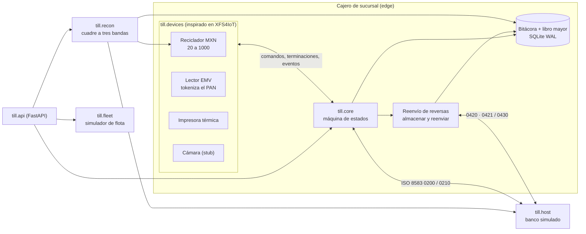
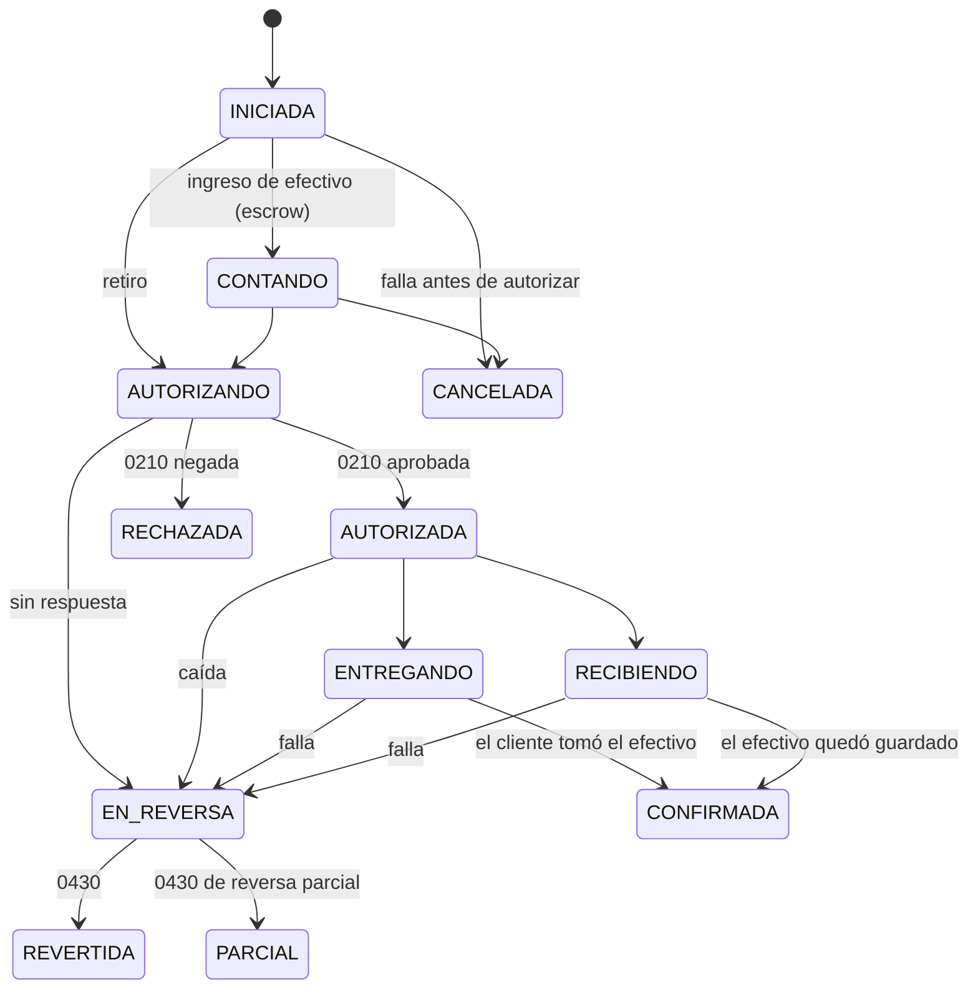

# Till

**Implementación de referencia, abierta, de una red de 15 mil cajeros de sucursal automatizados.**
Del dispositivo al centro de datos: reciclador de efectivo, lector EMV, enlace ISO 8583 con el banco,
libro mayor de partida doble, reversas que sobreviven a un apagón, cuadre de fin de día y un simulador
de flota que corre los 15 000 cajeros en menos de un segundo.

> Todo lo físico es simulado. Este repositorio no controla hardware real ni procesa tarjetas reales:
> sólo acepta PANs de prueba públicos. El diseño de hardware de referencia está en
> [`docs/hardware.md`](docs/hardware.md).

## Por qué existe

El 17 de noviembre de 2026 se publicó que un empresario mexicano planea sustituir a 15 mil cajeros
humanos de sucursal por máquinas: primero máquinas y después conectarlas a inteligencia artificial.

Till es la implementación de referencia de ese sistema, escrita para demostrar que se puede diseñar
completo —dispositivo, transacción, contabilidad, conciliación, operación de flota y despliegue— con
las reglas que un banco exige. No representa a ningún banco ni empresa: es «una red de 15 mil cajeros».

## Principio rector

**Una operación no cuenta hasta que el dispositivo confirma y el banco acusa recibo.**

De ahí sale todo lo demás:

- Un retiro se registra en el libro mayor sólo cuando el reciclador confirma que el cliente tomó el
  efectivo y el banco aprobó la 0200.
- Cualquier falla después de autorizar dispara una reversa (0420) por lo que no se entregó: total, o
  parcial con montos de reemplazo (campo 95). La reversa se guarda antes de enviarse y se reenvía
  (0421) hasta recibir el 0430, aunque el proceso muera a media operación.
- Nunca hay cargo sin entrega de efectivo, y nunca hay entrega sin cargo.
- Exactamente una vez: llave de idempotencia por solicitud, llave por asiento contable y un host que no
  aplica dos veces la misma 0200 ni la misma reversa.

## Plan por etapas

| Etapa | Qué es | Estado |
|---|---|---|
| **1. Automatización determinista** | Máquinas que hacen lo que hace un cajero humano en ventanilla (retiro, depósito, pago de crédito, envío de remesa) con garantías transaccionales y cuadre exacto. | **Este repositorio** (núcleo backend con pruebas, sin UI). |
| **2. IA detrás de una compuerta de reglas** | Asistente por voz, verificación de identidad por visión y detección de fraude. **La IA propone, las reglas autorizan**: ningún modelo mueve dinero; sus salidas son señales que una compuerta determinista acepta o rechaza, con bitácora. | Diseño; se monta sobre la Etapa 1 cuando ésta es estable a escala regional. |

El despliegue por oleadas (piloto de 50 sucursales → región → nacional) y lo que se mide en cada una
está en [`docs/etapas.md`](docs/etapas.md).

## Arquitectura



Máquina de estados de cada transacción (`till/core/bitacora.py` define las transiciones válidas; cualquier
otra se rechaza):



### Módulos

| Módulo | Qué hace |
|---|---|
| `till/devices/` | Dispositivos simulados con un modelo de comandos, terminaciones y eventos **inspirado en** XFS4IoT (no compatible): `CashDispenser.Dispense`, `CashDispenser.Present`, `CashAcceptor.CashIn/CashInEnd/CashInRollback`, `CardReader.ReadRawData/GenerateAC/Eject`, `Printer.PrintForm`, `Camera.TakePicture`. Interfaz asíncrona. **Inyección de fallas** por comando: atasco, entrega parcial, tiempo agotado, corte de energía a media operación y efectivo no retirado. El reciclador guarda en memoria no volátil la fase de cada operación para que, tras un corte, la aplicación pregunte qué pasó físicamente. |
| `till/seguridad.py` | Tokenización con llave (HMAC-SHA256), enmascarado 6+4, validación Luhn y lista de PANs de prueba; criptograma EMV simulado (ARQC) en el campo 55. |
| `till/host/` | Enlace ISO 8583 con [`pyiso8583`](https://github.com/knovichikhin/pyiso8583) (licencia MIT, verificada en el paquete instalado): 0200/0210, 0420/0421/0430 y 0800/0810. Host autorizador simulado con cuentas, saldos, límite diario, créditos y remesas; idempotente ante retransmisiones y reversas repetidas. Transporte en proceso con fallas (solicitud perdida, respuesta perdida, host caído, corte tras enviar) y transporte TCP con marco de 2 bytes. |
| `till/ledger/` | Libro mayor de partida doble, **sólo-anexar** (triggers de SQLite impiden UPDATE/DELETE), con llave de idempotencia por asiento. Cada casete de cada cajero es una cuenta. Asientos tipo para retiro, depósito, pago de crédito, envío de remesa, reabasto y movimientos internos (casete → rechazo/retenido). |
| `till/core/` | Máquina de estados AUTORIZAR → ENTREGAR/RECIBIR → CONFIRMAR, bitácora SQLite en modo WAL con escritura anticipada (el STAN se guarda antes de mandar la 0200; la reversa se guarda antes de mandar la 0420), historial de transiciones sólo-anexar, reenvío de reversas con espera exponencial y **recuperación al reiniciar**. |
| `till/recon/` | Cuadre de fin de día a tres bandas: conteo físico de casetes y bolsas contra libro mayor (por ubicación y denominación), libro contra totales del host (por tipo de operación), y lo que explica una diferencia legítima (reversas sin acuse, efectivo en tránsito, efectivo de clientes retenido en aclaración). |
| `till/fleet/` | Simulador agregado de N cajeros (hasta 15 000) con asyncio y tablas precalculadas, más una **muestra de alta fidelidad** que corre la máquina de estados real en N cajeros con fallas aleatorias y verifica que todos cuadren. Comando de benchmark. |
| `till/api/` | API FastAPI para una UI futura: operaciones por cajero, inyección de fallas, reinicio, reversas, libro mayor, cuadre y métricas de flota. Documentación interactiva en `/docs`. |

### Qué pasa con cada falla

| Falla inyectada | Resultado | Cargo al cliente | Libro mayor |
|---|---|---|---|
| Atasco o tiempo agotado al contar billetes | Reversa total (0420) | 0 | casete → rechazo |
| Entrega parcial | Reversa parcial con campo 95 | sólo lo entregado | lo entregado pasa por `transito:` hasta el 0430 |
| Efectivo no retirado / persiana atascada | Retracción + reversa total | 0 | casete → retenido |
| Corte de energía al contar | Al reiniciar: el reciclador purga a rechazo, reversa total | 0 | casete → rechazo |
| Corte de energía después de que el cliente tomó el efectivo | Al reiniciar: **se confirma** (no se revierte) | el monto completo | retiro normal |
| 0210 perdida, 0200 perdida, host caído, corte con la 0200 en el banco | Reversa total almacenada y reenviada; el banco tolera reversas sin original | 0 | — |
| 0430 perdido (una o varias veces, con reinicio de por medio) | 0421 hasta el acuse; el banco abona una sola vez | 0 | — |
| Depósito: atasco al guardar | Reversa total y devolución del efectivo | 0 | — |
| Depósito: atasco al guardar y al devolver, o corte de energía | Reversa total; el efectivo queda retenido **a nombre de la operación** | 0 (el efectivo queda en aclaración) | retenido ↔ `aclaraciones:` |
| Lector o chip fallan | Cancelada antes de autorizar | 0 | — |
| Impresora atascada | La operación se confirma; el comprobante se anota como no impreso | el monto completo | retiro normal |

Cada fila es una prueba en `tests/test_fallas.py`, y en todas se verifica que el libro mayor quede
balanceado, que el cuadre a tres bandas cuadre y que no haya un PAN en claro en disco. Además,
`tests/test_propiedades.py` (Hypothesis) genera secuencias aleatorias de operaciones con fallas
aleatorias —incluidos cortes de energía y acuses perdidos— y comprueba las mismas invariantes más
la conservación del efectivo y del saldo del cliente.

## Cómo correrlo

Requisitos: Python 3.12.

```bash
python3.12 -m venv .venv
.venv/bin/pip install -r requirements.txt

# Pruebas
.venv/bin/python -m pytest

# Benchmark de flota: 15 000 cajeros, un día, más una muestra de 20 cajeros con la máquina de estados real
.venv/bin/python -m till.fleet.bench --cajeros 15000 --horas 24 --muestra 20

# API (documentación interactiva en http://127.0.0.1:8000/docs)
.venv/bin/uvicorn till.api.app:app --port 8000
```

Ejemplos contra la API:

```bash
# Retiro de $2,500 con una tarjeta de prueba
curl -X POST localhost:8000/cajeros/TILL0001/operaciones \
  -H 'Content-Type: application/json' -H 'Idempotency-Key: demo-1' \
  -d '{"tipo": "retiro", "pan": "4111111111111111", "monto_pesos": 2500}'

# Programar una entrega parcial en el siguiente retiro
curl -X POST localhost:8000/cajeros/TILL0001/fallas -H 'Content-Type: application/json' \
  -d '{"dispositivo": "efectivo", "falla": "entrega_parcial", "comando": "CashDispenser.Dispense", "parametros": {"fraccion": 0.5}}'

# Simular un corte de energía, reiniciar y cuadrar
curl -X POST localhost:8000/cajeros/TILL0001/fallas -H 'Content-Type: application/json' \
  -d '{"dispositivo": "efectivo", "falla": "corte_energia", "comando": "CashDispenser.Dispense"}'
curl -X POST localhost:8000/cajeros/TILL0001/reiniciar
curl localhost:8000/cajeros/TILL0001/cuadre

# Métricas de una flota de 15 000 cajeros
curl -X POST localhost:8000/flota/simulacion -H 'Content-Type: application/json' -d '{"cajeros": 15000}'
```

La red de demostración (3 cajeros, 4 tarjetas de prueba, un crédito) arranca limpia en cada inicio:
el hardware simulado vive en memoria y no persiste entre ejecuciones.

## Resultados medidos

Medidos el 17-nov-2026 en una laptop de desarrollo (12 hilos, Linux), Python 3.12.3:

- `pytest`: **77 pruebas aprobadas** en ~8.6 s (la mayor parte es `fsync` de SQLite con
  `synchronous=FULL`): 34 de escenarios de falla, 1 de propiedades con 60 secuencias aleatorias,
  9 de API, 9 de dispositivos, 8 de ISO 8583 y host, 5 de mezcla de billetes, 4 de libro mayor,
  4 de flota y 3 de cuadre.
- Benchmark de flota con 15 000 cajeros × 24 h: **0.77 s** para el modelo agregado
  (≈2.3 millones de operaciones simuladas, ≈3.1 millones de operaciones/s) y **1.02 s** en total
  (1.08 s de reloj para el proceso completo, 32 MB de memoria máxima) incluyendo una muestra de
  20 cajeros × 15 operaciones con la máquina de estados real, fallas aleatorias y 13 reinicios por
  corte de energía; los 20 cuadraron y los saldos de los clientes fueron exactos.

Los parámetros del simulador (operaciones por día, tasas de falla, tiempo de reparación, cargas de
efectivo) son **supuestos ilustrativos**, no datos de una red real.

## Alcance honesto

Lo que **sí** hace: el flujo transaccional completo con garantías de exactamente una vez,
reversas almacenadas y reenviadas, recuperación tras corte, libro mayor de partida doble sólo-anexar,
cuadre a tres bandas, mensajes ISO 8583 reales en bytes, simulación de flota y una API.

Lo que está **simulado o simplificado**:

- **Hardware**: todos los dispositivos son simulados. No hay adaptador a un proveedor de servicios
  XFS4IoT real (WebSocket/JSON); el modelo de comandos y eventos sólo se inspira en él.
- **Seguridad de tarjeta**: la tokenización es un HMAC con llave de desarrollo; no hay PIN, EPP,
  DUKPT ni carga remota de llaves (TR-31/TR-34). El criptograma EMV es un HMAC, no el de EMV Book 2.
  Sólo se aceptan PANs de prueba públicos.
- **Enlace**: sin TLS/IPsec ni MAC (campo 64/128); los totales del host se leen del simulador en lugar
  de un archivo de liquidación o mensajes 0500/0510. Los códigos de proceso de pago de crédito y
  remesa son una convención del simulador.
- **Bitácora**: una base SQLite por red simulada (en producción, una por cajero y réplica al centro
  de datos). La recuperación asume que el dispositivo reporta su fase en memoria no volátil, como los
  equipos reales; el caso «estado desconocido» se resuelve revirtiendo.
- **Operación**: sin monedas, cheques, multimoneda, comisiones, flujo de aclaraciones con el cliente,
  monitoreo remoto ni ruteo de traslado de valores (el simulador sólo estima el día de reabasto).
- **Flota**: el modelo agregado no ejecuta la máquina de estados por cajero; la exactitud transaccional
  la cubre la muestra de alta fidelidad.
- **Etapa 2 (IA)**: no implementada; sólo diseñada en `docs/etapas.md`.

## Licencia

MIT. Ver [`LICENSE`](LICENSE). Dependencia de mensajería: `pyiso8583` (MIT).
