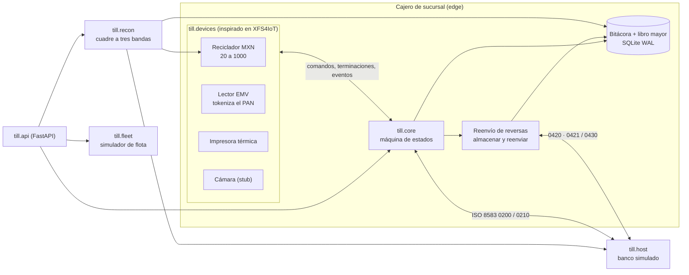
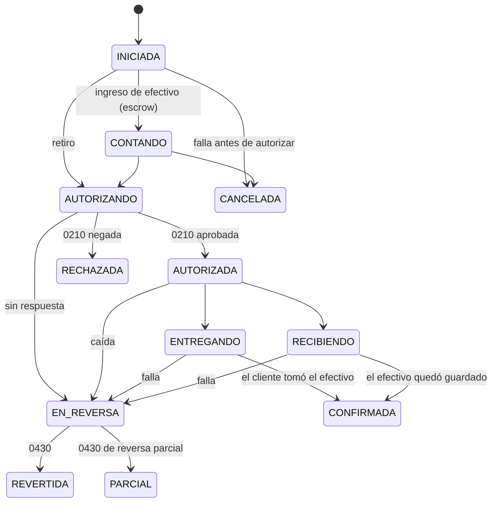

# Till

[](https://github.com/christianescamilla15-cell/till/actions/workflows/ci.yml)
[](https://github.com/christianescamilla15-cell/till/actions/workflows/seguridad.yml)

**Implementación de referencia, abierta, de una red de 15 mil cajeros de sucursal automatizados.**
Del dispositivo al centro de datos: reciclador de efectivo, lector EMV, enlace ISO 8583 con el banco,
libro mayor de partida doble, reversas que sobreviven a un apagón, cuadre de fin de día y un simulador
de flota que corre los 15 000 cajeros en menos de un segundo.

**Demo en vivo: [till-cajero.vercel.app](https://till-cajero.vercel.app)** — la API corre en tu navegador.

> Todo lo físico es simulado. Este repositorio no controla hardware real ni procesa tarjetas reales:
> sólo acepta PANs de prueba públicos. El diseño de hardware de referencia está en
> [`docs/hardware.md`](docs/hardware.md).

## Por qué existe

El 17 de noviembre de 2026 se publicó que un empresario mexicano planea sustituir a 15 mil cajeros
humanos de sucursal por máquinas: primero máquinas y después conectarlas a inteligencia artificial.

Till es la implementación de referencia de ese sistema, escrita para demostrar que se puede diseñar
completo —dispositivo, transacción, contabilidad, conciliación, operación de flota y despliegue— con
las reglas que un banco exige. No representa a ningún banco ni empresa: es «una red de 15 mil cajeros».

## Principio rector

**Una operación no cuenta hasta que el dispositivo confirma y el banco acusa recibo.**

De ahí sale todo lo demás:

- Un retiro se registra en el libro mayor sólo cuando el reciclador confirma que el cliente tomó el
  efectivo y el banco aprobó la 0200.
- Cualquier falla después de autorizar dispara una reversa (0420) por lo que no se entregó: total, o
  parcial con montos de reemplazo (campo 95). La reversa se guarda antes de enviarse y se reenvía
  (0421) hasta recibir el 0430, aunque el proceso muera a media operación.
- Nunca hay cargo sin entrega de efectivo, y nunca hay entrega sin cargo.
- Exactamente una vez: llave de idempotencia por solicitud, llave por asiento contable y un host que no
  aplica dos veces la misma 0200 ni la misma reversa.

## Plan por etapas

| Etapa | Qué es | Estado |
|---|---|---|
| **1. Automatización determinista** | Máquinas que hacen lo que hace un cajero humano en ventanilla (retiro, depósito, pago de crédito, envío de remesa) con garantías transaccionales y cuadre exacto. | **Este repositorio**: núcleo con pruebas y una [demo web](#demo-web) sobre la API real. |
| **2. IA detrás de una compuerta de reglas** | Asistente por voz, verificación de identidad por visión y detección de fraude. **La IA propone, las reglas autorizan**: ningún modelo mueve dinero; sus salidas son señales que una compuerta determinista acepta o rechaza, con bitácora. | Diseño; se monta sobre la Etapa 1 cuando ésta es estable a escala regional. |

El despliegue por oleadas (piloto de 50 sucursales → región → nacional) y lo que se mide en cada una
está en [`docs/etapas.md`](docs/etapas.md).

## Arquitectura

El paquete completo está en [`docs/arquitectura/`](docs/arquitectura/README.md): C4 (contexto, contenedores,
componentes y despliegue), [visión](docs/arquitectura/vision.md) al estilo TOGAF con línea base, objetivo y
hoja de ruta, [requisitos](docs/arquitectura/requisitos.md) trazados hasta las pruebas, modelo
[ArchiMate](docs/arquitectura/archimate.md) en el formato de intercambio de The Open Group, mapeo a
[BIAN](docs/arquitectura/bian.md), [UML](docs/arquitectura/uml.md) de estados y secuencias, y las decisiones
con sus alternativas descartadas en [`docs/adr/`](docs/adr/). Resumen:



Máquina de estados de cada transacción (`till/core/bitacora.py` define las transiciones válidas; cualquier
otra se rechaza):



### Módulos

| Módulo | Qué hace |
|---|---|
| `till/devices/` | Dispositivos simulados con un modelo de comandos, terminaciones y eventos **inspirado en** XFS4IoT (no compatible): `CashDispenser.Dispense`, `CashDispenser.Present`, `CashAcceptor.CashIn/CashInEnd/CashInRollback`, `CardReader.ReadRawData/GenerateAC/Eject`, `Printer.PrintForm`, `Camera.TakePicture`. Interfaz asíncrona. **Inyección de fallas** por comando: atasco, entrega parcial, tiempo agotado, corte de energía a media operación y efectivo no retirado. El reciclador guarda en memoria no volátil la fase de cada operación para que, tras un corte, la aplicación pregunte qué pasó físicamente. |
| `till/seguridad.py` | Tokenización con llave (HMAC-SHA256), enmascarado 6+4, validación Luhn y lista de PANs de prueba; criptograma EMV simulado (ARQC) en el campo 55. |
| `till/host/` | Enlace ISO 8583 con [`pyiso8583`](https://github.com/knovichikhin/pyiso8583) (licencia MIT, verificada en el paquete instalado): 0200/0210, 0420/0421/0430 y 0800/0810. Host autorizador simulado con cuentas, saldos, límite diario, créditos y remesas; idempotente ante retransmisiones y reversas repetidas. Transporte en proceso con fallas (solicitud perdida, respuesta perdida, host caído, corte tras enviar) y transporte TCP con marco de 2 bytes. |
| `till/ledger/` | Libro mayor de partida doble, **sólo-anexar** (triggers de SQLite impiden UPDATE/DELETE), con llave de idempotencia por asiento. Cada casete de cada cajero es una cuenta. Asientos tipo para retiro, depósito, pago de crédito, envío de remesa, reabasto y movimientos internos (casete → rechazo/retenido). |
| `till/core/` | Máquina de estados AUTORIZAR → ENTREGAR/RECIBIR → CONFIRMAR, bitácora SQLite en modo WAL con escritura anticipada (el STAN se guarda antes de mandar la 0200; la reversa se guarda antes de mandar la 0420), historial de transiciones sólo-anexar, reenvío de reversas con espera exponencial y **recuperación al reiniciar**. |
| `till/recon/` | Cuadre de fin de día a tres bandas: conteo físico de casetes y bolsas contra libro mayor (por ubicación y denominación), libro contra totales del host (por tipo de operación), y lo que explica una diferencia legítima (reversas sin acuse, efectivo en tránsito, efectivo de clientes retenido en aclaración). |
| `till/fleet/` | Simulador agregado de N cajeros (hasta 15 000) con asyncio y tablas precalculadas, más una **muestra de alta fidelidad** que corre la máquina de estados real en N cajeros con fallas aleatorias y verifica que todos cuadren. Comando de benchmark. |
| `till/api/` | API FastAPI: operaciones por cajero, inyección de fallas, reinicio, reversas, traza ISO 8583, libro mayor, cuadre y métricas de flota. Una red simulada por visitante (encabezado `X-Till-Sesion`) y las mismas rutas montables bajo `/api` para la demo web. Documentación interactiva en `/docs`. |
| `till/host/traza.py` | Traza de los mensajes ISO 8583 que viajan al banco (solicitud, respuesta o lo que pasó en su lugar), con el PAN enmascarado y sin el campo 55: es lo que la demo muestra. |
| `web/` | Demo web (Vite + React, sin librerías de UI): el cajero, el taller de fallas, los libros y la flota. |
| `api/index.py` | Entrada local: la API bajo `/api` y `web/dist` con la misma CSP que la demo publicada (que no la usa: corre la API en el navegador). |
| `web/src/motor/` | El motor de la demo publicada: Pyodide en un worker y el puente ASGI que entrega cada solicitud de la página a la app FastAPI. |

### Qué pasa con cada falla

| Falla inyectada | Resultado | Cargo al cliente | Libro mayor |
|---|---|---|---|
| Atasco o tiempo agotado al contar billetes | Reversa total (0420) | 0 | casete → rechazo |
| Entrega parcial | Reversa parcial con campo 95 | sólo lo entregado | lo entregado pasa por `transito:` hasta el 0430 |
| Efectivo no retirado / persiana atascada | Retracción + reversa total | 0 | casete → retenido |
| Corte de energía al contar | Al reiniciar: el reciclador purga a rechazo, reversa total | 0 | casete → rechazo |
| Corte de energía después de que el cliente tomó el efectivo | Al reiniciar: **se confirma** (no se revierte) | el monto completo | retiro normal |
| 0210 perdida, 0200 perdida, host caído, corte con la 0200 en el banco | Reversa total almacenada y reenviada; el banco tolera reversas sin original | 0 | — |
| 0430 perdido (una o varias veces, con reinicio de por medio) | 0421 hasta el acuse; el banco abona una sola vez | 0 | — |
| Depósito: atasco al guardar | Reversa total y devolución del efectivo | 0 | — |
| Depósito: atasco al guardar y al devolver, o corte de energía | Reversa total; el efectivo queda retenido **a nombre de la operación** | 0 (el efectivo queda en aclaración) | retenido ↔ `aclaraciones:` |
| Lector o chip fallan | Cancelada antes de autorizar | 0 | — |
| Impresora atascada | La operación se confirma; el comprobante se anota como no impreso | el monto completo | retiro normal |

Cada fila es una prueba en `tests/test_fallas.py`, y en todas se verifica que el libro mayor quede
balanceado, que el cuadre a tres bandas cuadre y que no haya un PAN en claro en disco. Además,
`tests/test_propiedades.py` (Hypothesis) genera secuencias aleatorias de operaciones con fallas
aleatorias —incluidos cortes de energía y acuses perdidos— y comprueba las mismas invariantes más
la conservación del efectivo y del saldo del cliente.

## Cómo ejecutarlo

Requisitos: Python 3.12.

```bash
python3.12 -m venv .venv
.venv/bin/pip install -r requirements-dev.txt   # requirements.txt sólo trae lo de ejecución

# Pruebas
.venv/bin/python -m pytest

# Benchmark de flota: 15 000 cajeros, un día, más una muestra de 20 cajeros con la máquina de estados real
.venv/bin/python -m till.fleet.bench --cajeros 15000 --horas 24 --muestra 20

# API (documentación interactiva en http://127.0.0.1:8000/docs)
.venv/bin/uvicorn till.api.app:app --port 8000
```

Ejemplos contra la API:

```bash
# Retiro de $2,500 con una tarjeta de prueba
curl -X POST localhost:8000/cajeros/TILL0001/operaciones \
  -H 'Content-Type: application/json' -H 'Idempotency-Key: demo-1' \
  -d '{"tipo": "retiro", "pan": "4111111111111111", "monto_pesos": 2500}'

# Programar una entrega parcial en el siguiente retiro
curl -X POST localhost:8000/cajeros/TILL0001/fallas -H 'Content-Type: application/json' \
  -d '{"dispositivo": "efectivo", "falla": "entrega_parcial", "comando": "CashDispenser.Dispense", "parametros": {"fraccion": 0.5}}'

# Simular un corte de energía, reiniciar y cuadrar
curl -X POST localhost:8000/cajeros/TILL0001/fallas -H 'Content-Type: application/json' \
  -d '{"dispositivo": "efectivo", "falla": "corte_energia", "comando": "CashDispenser.Dispense"}'
curl -X POST localhost:8000/cajeros/TILL0001/reiniciar
curl localhost:8000/cajeros/TILL0001/cuadre

# Métricas de una flota de 15 000 cajeros
curl -X POST localhost:8000/flota/simulacion -H 'Content-Type: application/json' -d '{"cajeros": 15000}'
```

La red de demostración (3 cajeros, 4 tarjetas de prueba, un crédito) arranca limpia en cada inicio:
el hardware simulado vive en memoria y no persiste entre ejecuciones.

## Demo web

`web/` es la interfaz que ve una persona desde el portafolio: una sola página con cuatro zonas sobre
la API real del núcleo (nada está pregrabado).

1. **El cajero.** La pantalla del cliente, igual a la del render del portafolio (degradado azul noche,
   acento turquesa, Noto Sans): «Acercar tarjeta de prueba», elegir operación (retiro, depósito, pago de
   crédito, remesa), monto o billetes, confirmar, «Toma tu efectivo» y el comprobante que imprimió la
   impresora simulada. Sólo PANs de prueba; en pantalla, traza y base sólo queda el PAN enmascarado.
2. **El taller de fallas.** Arma una falla para la siguiente operación —atasco, entrega parcial, tiempo
   agotado (el banco aprueba y su 0210 se pierde), corte de energía a media entrega o enlace caído— o
   reinicia el cajero. Muestra la línea de tiempo real de la transacción (AUTORIZAR → ENTREGAR →
   CONFIRMAR o REVERTIR, con sus transiciones y milisegundos), los mensajes ISO 8583 que viajaron (tipo y
   campos principales, PAN enmascarado) y la reversa reintentándose (0420, 0421…) hasta el 0430.
3. **Los libros.** Saldo del cliente y adeudo del crédito en el banco, efectivo por casete (y en rechazo
   o retenido), el libro mayor con sus asientos recientes y la verificación de partida doble, y «Cuadrar
   el día» con las tres bandas.
4. **La flota.** Corre el simulador agregado con 1 a 15 000 cajeros (1 día, 3 días o una semana):
   disponibilidad, operaciones, fallas, reversas, reabasto estimado por día y el tiempo que tardó; y la
   muestra de alta fidelidad (20 cajeros con la máquina de estados real).

Español e inglés (selector ES/EN o `?lang=en`). Sin animaciones decorativas, contraste AA, foco visible,
todo operable con teclado y, en celular, las zonas se apilan con el cajero primero. Todo se sirve desde
el mismo origen (tipografías Noto Sans con licencia OFL en `web/public/fonts`) y funciona con una CSP
estricta: `default-src 'self'`, sin `eval` ni estilos en línea; lo único extra es `'wasm-unsafe-eval'`,
que permite compilar WebAssembly (no habilita `eval` de JavaScript).

### Dónde corre la API: en el navegador

La demo publicada no tiene servidor. La página carga **Pyodide** (CPython 3.14 compilado a
WebAssembly) en un *web worker* y le entrega cada solicitud `/api/...` a la misma app FastAPI de
`till/api`, como una llamada ASGI (`web/src/motor/puente.py`). Es el mismo código que pasa las pruebas;
las bases SQLite van al sistema de archivos en memoria del worker.

Por qué: la red simulada (banco, cajero, bitácora, libro, reversas pendientes) vive en memoria, y una
plataforma sin servidor reparte las solicitudes de una misma pestaña entre instancias que no comparten
memoria. Medido en Vercel con la API como función de Python: 24 solicitudes simultáneas cayeron en
9 instancias distintas, y el comprobante de un retiro llegaba a una instancia que no conocía la
operación. En el navegador cada pestaña tiene su red completa, el ciclo de fondo que reenvía reversas
nunca se congela y no hay estado del lado del servidor.

El costo es la primera carga: ~7 MB comprimidos (intérprete, biblioteca estándar y 13 paquetes:
FastAPI, Starlette, Pydantic, pyiso8583, la base de zonas horarias `tzdata`…), que después quedan en caché. `web/scripts/preparar_motor.mjs`
los prepara antes de cada build: copia el intérprete del paquete npm `pyodide`, descarga sólo los
paquetes necesarios verificando el sha256 de su lockfile (FastAPI sin httpx ni jinja2) y empaqueta el
código de `till/`. Con `VITE_TILL_MOTOR=servidor` la página usa en cambio uvicorn por HTTP.

### Levantarla en local

Requisitos: Python 3.12 y Node 18 o posterior.

```bash
# Tal como se publica (API en el navegador), servido con la misma CSP de producción
npm ci --prefix web && npm run build --prefix web
.venv/bin/uvicorn api.index:app --port 8000          # http://127.0.0.1:8000

# Desarrollo: Vite con recarga en caliente (la API también corre en el navegador)
npm run dev --prefix web                              # http://127.0.0.1:5173

# Depurar la API con sus registros: la página va por HTTP a uvicorn
.venv/bin/uvicorn api.index:app --port 8000          # terminal 1
VITE_TILL_MOTOR=servidor npm run dev --prefix web     # terminal 2 (TILL_API cambia el destino del proxy)
```

Las bases SQLite de la demo van a `datos/` (o a `TILL_DATOS`, si se define) y arrancan limpias en
cada inicio.

### Recorrido en un navegador real

`web/scripts/recorrido.mjs` maneja Chrome con `puppeteer-core` (no es dependencia del proyecto: se le
pasa la ruta del paquete) y recorre un retiro exitoso con teclado, un atasco con reversa, un enlace
caído con reintentos hasta el 0430, un corte de energía con reinicio, depósito, pago de crédito,
remesa, un rechazo por fondos insuficientes, la flota de 15 000 cajeros, la versión en inglés y la vista
de celular. Falla si hay errores de consola o violaciones de CSP, y deja capturas en `web/capturas/`.

```bash
TILL_URL=http://127.0.0.1:8000 PUPPETEER_CORE=/ruta/a/node_modules/puppeteer-core npm run recorrido --prefix web
```

### Lo que la API agrega para la demo

- `crear_app(prefijo="/api")` monta las mismas rutas bajo `/api`; `till.api.app:app` sigue en la raíz.
- Encabezado `X-Till-Sesion`: cada pestaña tiene su propia red (banco, cajero, bitácora, libro), así la
  falla que arma una persona no la dispara otra. Hay tope de sesiones y se descartan las inactivas.
- `GET /cajeros/{t}/tablero` (todo lo que la página pinta, en una llamada), los mensajes ISO 8583 y el
  comprobante en `GET /operaciones/{id}`, `GET /iso/mensajes`, `GET /enlace/fallas` y
  `POST /reversas/drenar?respetar_espera=true` (un reintento sólo de lo que ya cumplió su espera).

## Desplegar en Vercel

Publicada en [till-cajero.vercel.app](https://till-cajero.vercel.app). Es un sitio estático; `vercel.json`
define todo:

- **Build:** `npm ci --prefix web` y `npm run build --prefix web` (que antes prepara el motor); se publica
  `web/dist`. `.vercelignore` deja fuera `api/` y los archivos de Python: no se crea ninguna función.
- **Encabezados:** la misma CSP y encabezados de seguridad que `api/index.py` usa en local (una prueba
  verifica que coincidan); caché inmutable para `/assets/*` y para el intérprete en
  `/motor/pyodide-<versión>/*`. `till.json` (el código de Till) se revalida en cada visita.
- La CSP fija `frame-ancestors 'none'`: la demo no se deja incrustar en otras páginas (el portafolio la
  enlaza en su propia pestaña).

Con la CLI: `vercel` (vista previa) y `vercel --prod`. No hacen falta variables de entorno. El procedimiento
completo —qué revisar antes, la prueba de humo posterior (`herramientas/humo.sh`) y cómo revertir— está en
[`RUNBOOK.md`](RUNBOOK.md).

## Pruebas

```bash
.venv/bin/python -m pytest                       # 696 casos (158 funciones de prueba)
npm run build --prefix web && npm run humo:motor --prefix web   # la API real en Pyodide, desde web/dist
TILL_PYTHON=$PWD/.venv/bin/python npm test --prefix e2e        # E2E con Playwright sobre el build local
```

La compuerta no es el porcentaje de cobertura (el CI lo reporta: 94 %) sino [`docs/reglas.md`](docs/reglas.md):
**95 reglas de negocio, cada una con sus pruebas**, y una prueba que falla si la tabla cita una prueba que no
existe o que se salta. Además:

- **Máquinas de estado completas**: las 144 parejas de estados de la operación (lo no permitido se rechaza sin
  tocar nada), la recuperación desde cada estado no final, la reversa, el lector y el reciclador con sus
  comandos fuera de estado, y las sesiones de la demo (`tests/test_maquinas_de_estado.py`).
- **Casos límite parametrizados**: montos contra `Decimal`, denominaciones, máximo de billetes, límite diario
  en sus bordes y por día de negocio en hora de México, reintentos con espera exponencial, solicitudes
  duplicadas y simultáneas, reverso parcial y tiempo agotado real (`tests/test_bordes.py`).
- **Paridad contra un oráculo**: un día de operación contra un lote golden escrito a mano, con cifras control
  y controles negativos (`tests/test_paridad_golden.py`).
- **Arquitectura y contrato**: capas sin dependencias hacia arriba, dominio sin API ni transporte web,
  contrato OpenAPI versionado en [`docs/api/openapi.json`](docs/api/openapi.json) que falla si cambia sin
  regenerarlo.
- **El runtime publicado**: el CI corre toda la suite con el Python 3.14 y los paquetes de Pyodide, la prueba
  de humo del motor en WebAssembly y un E2E de un retiro completo en Chromium.

## Seguridad

Cómo reportar una vulnerabilidad, qué escanea cada cambio (CodeQL, Semgrep, Trivy, gitleaks, SBOM) y qué
controles del dominio la sostienen: [`SECURITY.md`](SECURITY.md).

## Resultados medidos

Medidos en una laptop de desarrollo (12 hilos, Linux), Python 3.12.3:

- `pytest` (24-nov-2026): **696 casos aprobados** de 158 funciones en ~32 s (la mayor parte es `fsync` de
  SQLite con `synchronous=FULL`): 220 de máquinas de estado, 130 de casos límite, 131 del modelo ArchiMate,
  68 de arquitectura, 34 de escenarios de falla, 30 del contrato OpenAPI, 14 de ISO 8583 y host, 11 de
  dispositivos, 9 de API, 7 de la API de la demo, 7 de paridad golden, 6 de mezcla de billetes, 5 de traza,
  4 de cuadre, 4 de libro mayor, 4 de flota, 4 de la entrada local y `vercel.json`, 4 de la tabla de reglas,
  3 del puente del motor y 1 de propiedades con 60 secuencias aleatorias. La misma suite pasa con Python
  3.14.10 y las versiones de FastAPI y Pydantic del lockfile de Pyodide.
- Demo web (18-nov-2026): `npm run build` produce 221 KB de JavaScript (70 KB comprimido), 22 KB de
  CSS y el motor (Pyodide 314.0.8 con Python 3.14.2 y 12 paquetes, ~7 MB comprimidos; desde el 24-nov son 13,
  con `tzdata`, +0.35 MB). El recorrido en
  Chrome (27 pasos, ver arriba) terminó sin errores de consola ni violaciones de CSP; el motor quedó listo
  3.0–3.4 s después de cargar la página (en local) y la flota de 15 000 cajeros × 24 h tardó 1.39 s
  dentro del navegador (0.67–0.77 s con CPython nativo).
- Benchmark de flota con 15 000 cajeros × 24 h: **0.77 s** para el modelo agregado
  (≈2.3 millones de operaciones simuladas, ≈3.1 millones de operaciones/s) y **1.02 s** en total
  (1.08 s de reloj para el proceso completo, 32 MB de memoria máxima) incluyendo una muestra de
  20 cajeros × 15 operaciones con la máquina de estados real, fallas aleatorias y 13 reinicios por
  corte de energía; los 20 cuadraron y los saldos de los clientes fueron exactos.

Los parámetros del simulador (operaciones por día, tasas de falla, tiempo de reparación, cargas de
efectivo) son **supuestos ilustrativos**, no datos de una red real.

## Alcance honesto

Lo que **sí** hace: el flujo transaccional completo con garantías de exactamente una vez,
reversas almacenadas y reenviadas, recuperación tras corte, libro mayor de partida doble sólo-anexar,
cuadre a tres bandas, mensajes ISO 8583 reales en bytes, simulación de flota y una API.

Lo que está **simulado o simplificado**:

- **Hardware**: todos los dispositivos son simulados. No hay adaptador a un proveedor de servicios
  XFS4IoT real (WebSocket/JSON); el modelo de comandos y eventos sólo se inspira en él.
- **Seguridad de tarjeta**: la tokenización es un HMAC con llave de desarrollo; no hay PIN, EPP,
  DUKPT ni carga remota de llaves (TR-31/TR-34). El criptograma EMV es un HMAC, no el de EMV Book 2.
  Sólo se aceptan PANs de prueba públicos.
- **Enlace**: sin TLS/IPsec ni MAC (campo 64/128); los totales del host se leen del simulador en lugar
  de un archivo de liquidación o mensajes 0500/0510. Los códigos de proceso de pago de crédito y
  remesa son una convención del simulador.
- **Bitácora**: una base SQLite por red simulada (en producción, una por cajero y réplica al centro
  de datos). La recuperación asume que el dispositivo reporta su fase en memoria no volátil, como los
  equipos reales; el caso «estado desconocido» se resuelve revirtiendo.
- **Operación**: sin monedas, cheques, multimoneda, comisiones, flujo de aclaraciones con el cliente,
  monitoreo remoto ni ruteo de traslado de valores (el simulador sólo estima el día de reabasto).
- **Flota**: el modelo agregado no ejecuta la máquina de estados por cajero; la exactitud transaccional
  la cubre la muestra de alta fidelidad.
- **Etapa 2 (IA)**: no implementada; sólo diseñada en `docs/etapas.md`. En la demo web, el asistente
  de voz de la pantalla es un aviso de la Etapa 2, y donde el render dice «Identidad verificada» la demo
  muestra la tarjeta leída: en la Etapa 1 no hay verificación de identidad.
- **Demo web**: la red simulada vive en la pestaña; al recargar empieza de cero. La primera visita baja
  ~7 MB (ver [Dónde corre la API](#dónde-corre-la-api-en-el-navegador)).

## Licencia

MIT. Ver [`LICENSE`](LICENSE). Dependencia de mensajería: `pyiso8583` (MIT).
