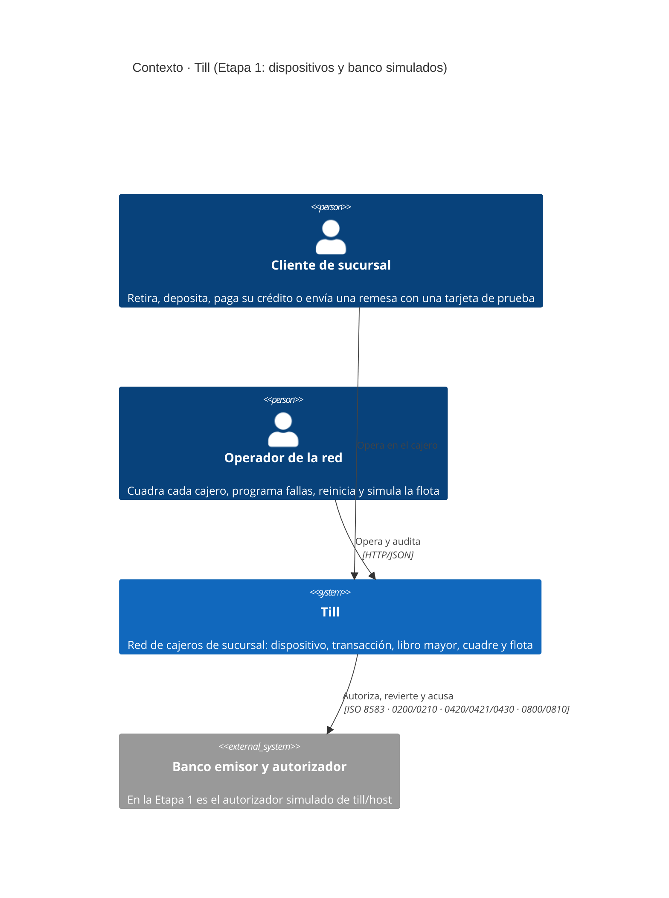
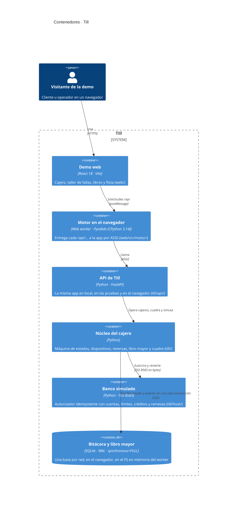
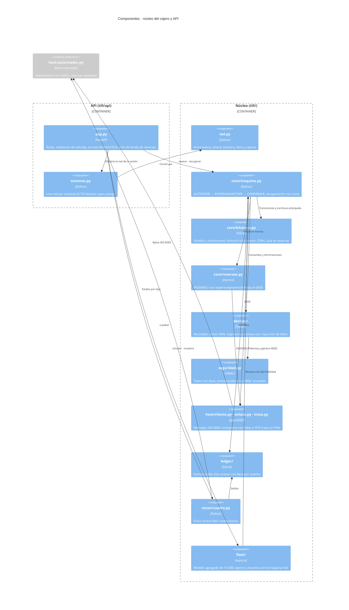

# Arquitectura · Till

Modelo C4 (contexto → contenedores → componentes → despliegue) en Mermaid, hecho con los módulos reales del
repositorio. Los diagramas son texto y se versionan con el código.

## Paquete de arquitectura empresarial

| Documento | Qué contiene |
|---|---|
| [`vision.md`](vision.md) | Visión de arquitectura al estilo TOGAF ADM ligero: drivers, metas, principios, partes interesadas, línea base contra objetivo, brechas y hoja de ruta. |
| [`requisitos.md`](requisitos.md) | Requisitos funcionales y no funcionales con trazabilidad requisito → componente → regla → prueba. |
| [`archimate.md`](archimate.md) y [`till.archimate.xml`](till.archimate.xml) | Modelo ArchiMate 3.1 (motivación, negocio, aplicación, tecnología, migración) en el formato de intercambio de The Open Group, validado contra su XSD, y su vista legible. |
| [`bian.md`](bian.md) | Componentes de Till contra dominios de servicio BIAN (release 14.0), con lo que no tiene equivalente. |
| [`uml.md`](uml.md) | Estados de la operación y de la reversa; secuencias de retiro, reversa tras apagón, cuadre y solicitud de la demo. |
| [`../adr/`](../adr/) | Decisiones con sus alternativas descartadas. |
| [`../reglas.md`](../reglas.md) | Reglas de negocio → pruebas (la compuerta de calidad). |

## 1. Contexto



## 2. Contenedores



## 3. Componentes del núcleo y de la API



Las capas son una regla, no una sugerencia: `tests/test_arquitectura.py` falla si un módulo importa una capa
superior (dinero/seguridad/db → dispositivos y libro → host → core → recon → red → flota → API) o si el
dominio importa FastAPI, Starlette, Pydantic, uvicorn o httpx.

## 4. Despliegue

```mermaid
C4Deployment
  title Despliegue · demo publicada (sitio estático) y entorno local
  Deployment_Node(vercel, "Vercel", "CDN, sitio estático") {
    Container(sitio, "web/dist", "HTML, JS, CSS, motor/", "CSP estricta de vercel.json; sin funciones")
  }
  Deployment_Node(navegador, "Navegador del visitante", "Chrome, Firefox, Safari") {
    Deployment_Node(worker, "Web worker", "Pyodide 314 · CPython 3.14 · WebAssembly") {
      Container(api_nav, "API de Till", "FastAPI", "La red simulada de la pestaña, en memoria")
      ContainerDb(bd_nav, "SQLite", "FS en memoria", "Bitácora y libro")
    }
  }
  Deployment_Node(local, "Equipo de desarrollo o CI", "Linux · CPython 3.12") {
    Container(uvicorn, "api.index:app", "uvicorn", "La API bajo /api y web/dist con la misma CSP (pruebas, E2E)")
  }
  Rel(navegador, vercel, "Descarga el sitio y el motor", "HTTPS")
```

El despliegue real, la reversa y la prueba de humo posterior están en [`RUNBOOK.md`](../../RUNBOOK.md); el
porqué de correr la API en el navegador, en el [ADR 0002](../adr/0002-api-en-el-navegador-con-pyodide.md).
