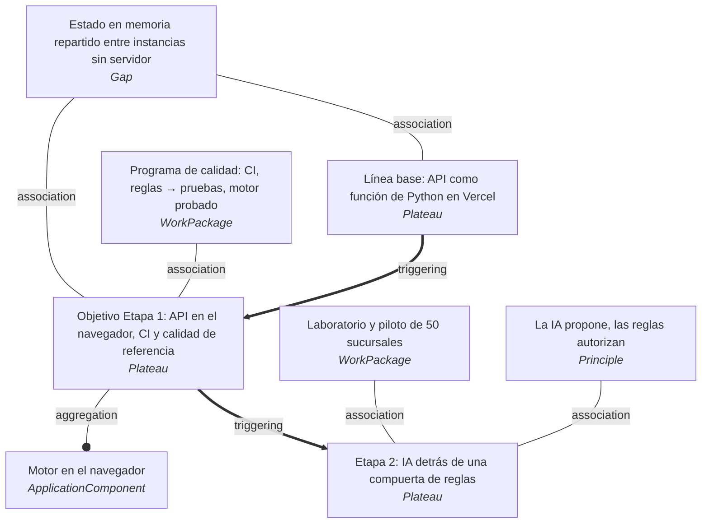

# ArchiMate · vista legible

> Generado por `herramientas/archimate.py` a partir del mismo modelo que [`till.archimate.xml`](till.archimate.xml) (formato de intercambio de The Open Group, ArchiMate 3.1). No se edita a mano: `python3 herramientas/archimate.py` regenera los dos archivos y `tests/test_archimate.py` falla si no coinciden.

El modelo tiene **98 elementos**, **126 relaciones** y **5 vistas**. Cada componente de aplicación y cada objeto de datos lleva la propiedad «código» con el archivo que lo implementa. Para abrirlo en una herramienta de modelado (p. ej. Archi): *File → Import → Open Exchange XML Model*.

Notación en los diagramas: `--*` composición, `--o` agregación, `-->` asignación o servicio, `-.->` realización, influencia o flujo (el texto lo dice), `-.-` acceso, `==>` disparo, `---` asociación.

## Motivación

Por qué existe Till y qué principios lo gobiernan. Los requisitos citan las reglas de docs/reglas.md.

```mermaid
flowchart TB
    st_cliente["Cliente de sucursal<br/><i>Stakeholder</i>"]
    st_banco["Banco (emisor y adquirente)<br/><i>Stakeholder</i>"]
    st_operacion["Operación de la red<br/><i>Stakeholder</i>"]
    st_cumplimiento["Riesgo, cumplimiento y auditoría<br/><i>Stakeholder</i>"]
    dr_confianza["Confianza del cliente en el efectivo<br/><i>Driver</i>"]
    dr_sustitucion["Sustituir 15 000 cajeros humanos de sucursal por máquinas<br/><i>Driver</i>"]
    dr_pci["Datos de tarjeta bajo PCI DSS<br/><i>Driver</i>"]
    as_cargo["Un cargo sin entrega (o una entrega sin cargo) rompe la confianza<br/><i>Assessment</i>"]
    go_exactitud["Nunca cargo sin entrega ni entrega sin cargo<br/><i>Goal</i>"]
    go_cuadre["Cuadre diario exacto a tres bandas<br/><i>Goal</i>"]
    go_disponibilidad["Disponibilidad medible por cajero a escala de 15 000<br/><i>Goal</i>"]
    go_pan["Ningún PAN en claro fuera de la sesión de tarjeta<br/><i>Goal</i>"]
    pr_rector["Una operación no cuenta hasta que el dispositivo confirma y el banco acusa recibo<br/><i>Principle</i>"]
    pr_una_vez["Exactamente una vez<br/><i>Principle</i>"]
    pr_anexar["Sólo anexar<br/><i>Principle</i>"]
    pr_ia["La IA propone, las reglas autorizan<br/><i>Principle</i>"]
    rq_reversa["RF-03 · Toda falla tras autorizar se revierte por lo no entregado<br/><i>Requirement</i>"]
    rq_recuperacion["RNF-03 · Recuperar tras un corte sin perder ni duplicar<br/><i>Requirement</i>"]
    rq_idempotencia["RF-05 · Idempotencia de la solicitud<br/><i>Requirement</i>"]
    rq_auditoria["RNF-06 · Rastro de auditoría sólo-anexar<br/><i>Requirement</i>"]
    rq_pan["RNF-05 · Tokenizar el PAN en el borde<br/><i>Requirement</i>"]
    rq_cuadre["RF-06 · Cuadre físico = libro = banco<br/><i>Requirement</i>"]
    co_pan_prueba["Sólo PANs de prueba públicos<br/><i>Constraint</i>"]
    co_estatica["La demo pública es un sitio estático sin servidor<br/><i>Constraint</i>"]
    st_cliente ---|"association"| dr_confianza
    st_banco ---|"association"| dr_sustitucion
    st_operacion ---|"association"| dr_sustitucion
    st_cumplimiento ---|"association"| dr_pci
    dr_confianza -.->|"influence"| as_cargo
    as_cargo -.->|"influence"| go_exactitud
    dr_sustitucion -.->|"influence"| go_disponibilidad
    dr_pci -.->|"influence"| go_pan
    dr_confianza -.->|"influence"| go_cuadre
    pr_rector -.->|"realization"| go_exactitud
    pr_una_vez -.->|"realization"| go_exactitud
    pr_anexar -.->|"realization"| go_cuadre
    rq_reversa -.->|"realization"| pr_rector
    rq_recuperacion -.->|"realization"| pr_rector
    rq_idempotencia -.->|"realization"| pr_una_vez
    rq_auditoria -.->|"realization"| pr_anexar
    rq_pan -.->|"realization"| go_pan
    rq_cuadre -.->|"realization"| go_cuadre
    co_pan_prueba -.->|"influence"| rq_pan
```



| Elemento | Tipo | Código o fuente |
|---|---|---|
| Cliente de sucursal — Quien retira, deposita, paga su crédito o envía dinero. | Stakeholder | — |
| Banco (emisor y adquirente) — Dueño de las cuentas y de la red de cajeros. | Stakeholder | — |
| Operación de la red — Soporte técnico, monitoreo y traslado de valores. | Stakeholder | [`docs/etapas.md`](../../docs/etapas.md) |
| Riesgo, cumplimiento y auditoría — PCI DSS, auditoría interna y regulación. | Stakeholder | — |
| Confianza del cliente en el efectivo — El cliente tiene que confiar en la máquina como en la ventanilla. | Driver | — |
| Sustituir 15 000 cajeros humanos de sucursal por máquinas — El motivo de Till (README, «Por qué existe»). | Driver | [`README.md`](../../README.md) |
| Datos de tarjeta bajo PCI DSS — El PAN y el PIN tienen reglas de manejo obligatorias. | Driver | [`till/seguridad.py`](../../till/seguridad.py) |
| Un cargo sin entrega (o una entrega sin cargo) rompe la confianza — Es el modo de falla que más aclaraciones y quejas genera en una red de cajeros. | Assessment | — |
| Nunca cargo sin entrega ni entrega sin cargo — Principio rector del README. | Goal | [`README.md`](../../README.md) |
| Cuadre diario exacto a tres bandas — Físico = libro mayor = banco, todos los días. | Goal | [`till/recon/cuadre.py`](../../till/recon/cuadre.py) |
| Disponibilidad medible por cajero a escala de 15 000 — Metas por oleada en docs/etapas.md. | Goal | [`docs/etapas.md`](../../docs/etapas.md) |
| Ningún PAN en claro fuera de la sesión de tarjeta — Ni en disco, ni en trazas, ni en comprobantes. | Goal | [`till/seguridad.py`](../../till/seguridad.py) |
| Una operación no cuenta hasta que el dispositivo confirma y el banco acusa recibo — De aquí salen la máquina de estados, las reversas y la recuperación. | Principle | [`till/core/maquina.py`](../../till/core/maquina.py) |
| Exactamente una vez — Llave por solicitud, llave por asiento y un banco idempotente. | Principle | [`till/core/bitacora.py`](../../till/core/bitacora.py) |
| Sólo anexar — Una corrección es otro asiento; el historial no se reescribe. | Principle | [`till/ledger/libro.py`](../../till/ledger/libro.py) |
| La IA propone, las reglas autorizan — Etapa 2: ningún modelo mueve dinero. | Principle | [`docs/etapas.md`](../../docs/etapas.md) |
| RF-03 · Toda falla tras autorizar se revierte por lo no entregado — Total o parcial con campo 95; reglas R1–R9. | Requirement | [`docs/reglas.md`](../../docs/reglas.md) |
| RNF-03 · Recuperar tras un corte sin perder ni duplicar — Reglas E8, I7, F4. | Requirement | [`docs/reglas.md`](../../docs/reglas.md) |
| RF-05 · Idempotencia de la solicitud — Reglas I1–I3. | Requirement | [`docs/reglas.md`](../../docs/reglas.md) |
| RNF-06 · Rastro de auditoría sólo-anexar — Reglas E3, L2. | Requirement | [`docs/reglas.md`](../../docs/reglas.md) |
| RNF-05 · Tokenizar el PAN en el borde — Reglas P1–P5. | Requirement | [`docs/reglas.md`](../../docs/reglas.md) |
| RF-06 · Cuadre físico = libro = banco — Reglas C1–C7. | Requirement | [`docs/reglas.md`](../../docs/reglas.md) |
| Sólo PANs de prueba públicos — Etapa 1: todo lo físico y el banco son simulados. | Constraint | [`till/seguridad.py`](../../till/seguridad.py) |
| La demo pública es un sitio estático sin servidor — ADR 0002. | Constraint | [`docs/adr/0002-api-en-el-navegador-con-pyodide.md`](../../docs/adr/0002-api-en-el-navegador-con-pyodide.md) |

## Negocio

Los servicios de ventanilla que el cajero automatiza y los procesos que los realizan.

```mermaid
flowchart TB
    ba_cliente["Cliente<br/><i>BusinessActor</i>"]
    br_tarjetahabiente["Tarjetahabiente<br/><i>BusinessRole</i>"]
    ba_banco["Banco<br/><i>BusinessActor</i>"]
    ba_operador["Operador de la red<br/><i>BusinessActor</i>"]
    bs_retiro["Retiro de efectivo<br/><i>BusinessService</i>"]
    bs_deposito["Depósito en efectivo<br/><i>BusinessService</i>"]
    bs_pago["Pago de crédito en efectivo<br/><i>BusinessService</i>"]
    bs_remesa["Envío de remesa en efectivo<br/><i>BusinessService</i>"]
    bs_cuadre["Cuadre de fin de día<br/><i>BusinessService</i>"]
    bs_flota["Planeación de la flota y del reabasto<br/><i>BusinessService</i>"]
    bp_operacion["Operación en el cajero: autorizar → entregar o recibir → confirmar<br/><i>BusinessProcess</i>"]
    bp_reversa["Reversa: almacenar y reenviar hasta el acuse<br/><i>BusinessProcess</i>"]
    bp_recuperacion["Recuperación tras un corte de energía<br/><i>BusinessProcess</i>"]
    bp_cuadre["Cuadre a tres bandas<br/><i>BusinessProcess</i>"]
    bo_operacion["Operación<br/><i>BusinessObject</i>"]
    bo_asiento["Asiento contable<br/><i>BusinessObject</i>"]
    bo_reversa["Reversa<br/><i>BusinessObject</i>"]
    bo_comprobante["Comprobante<br/><i>BusinessObject</i>"]
    bo_aclaracion["Aclaración (efectivo retenido)<br/><i>BusinessObject</i>"]
    ba_cliente -->|"assignment"| br_tarjetahabiente
    bs_retiro -->|"serving"| br_tarjetahabiente
    bs_deposito -->|"serving"| br_tarjetahabiente
    bs_pago -->|"serving"| br_tarjetahabiente
    bs_remesa -->|"serving"| br_tarjetahabiente
    bs_cuadre -->|"serving"| ba_operador
    bs_flota -->|"serving"| ba_operador
    bp_operacion -.->|"realization"| bs_retiro
    bp_operacion -.->|"realization"| bs_deposito
    bp_operacion -.->|"realization"| bs_pago
    bp_operacion -.->|"realization"| bs_remesa
    bp_cuadre -.->|"realization"| bs_cuadre
    bp_operacion ==>|"triggering · falla tras autorizar"| bp_reversa
    bp_recuperacion ==>|"triggering · sin prueba de entrega"| bp_reversa
    bp_operacion -.-|"access"| bo_operacion
    bp_operacion -.-|"access"| bo_comprobante
    bp_operacion -.-|"access"| bo_aclaracion
    bp_operacion -.-|"access"| bo_asiento
    bp_reversa -.-|"access"| bo_reversa
    bp_cuadre -.-|"access"| bo_asiento
    ba_banco ---|"association · autoriza"| bp_operacion
    ba_banco ---|"association · acusa"| bp_reversa
```



| Elemento | Tipo | Código o fuente |
|---|---|---|
| Cliente | BusinessActor | — |
| Tarjetahabiente | BusinessRole | — |
| Banco — Autoriza (0210) y acusa reversas (0430). | BusinessActor | [`till/host/autorizador.py`](../../till/host/autorizador.py) |
| Operador de la red | BusinessActor | — |
| Retiro de efectivo | BusinessService | [`till/core/maquina.py`](../../till/core/maquina.py) |
| Depósito en efectivo | BusinessService | [`till/core/maquina.py`](../../till/core/maquina.py) |
| Pago de crédito en efectivo | BusinessService | [`till/core/maquina.py`](../../till/core/maquina.py) |
| Envío de remesa en efectivo — Con clave de cobro. | BusinessService | [`till/core/maquina.py`](../../till/core/maquina.py) |
| Cuadre de fin de día | BusinessService | [`till/recon/cuadre.py`](../../till/recon/cuadre.py) |
| Planeación de la flota y del reabasto | BusinessService | [`till/fleet/simulador.py`](../../till/fleet/simulador.py) |
| Operación en el cajero: autorizar → entregar o recibir → confirmar | BusinessProcess | [`till/core/maquina.py`](../../till/core/maquina.py) |
| Reversa: almacenar y reenviar hasta el acuse | BusinessProcess | [`till/core/reversas.py`](../../till/core/reversas.py) |
| Recuperación tras un corte de energía | BusinessProcess | [`till/core/maquina.py`](../../till/core/maquina.py) |
| Cuadre a tres bandas | BusinessProcess | [`till/recon/cuadre.py`](../../till/recon/cuadre.py) |
| Operación | BusinessObject | — |
| Asiento contable | BusinessObject | — |
| Reversa | BusinessObject | — |
| Comprobante | BusinessObject | — |
| Aclaración (efectivo retenido) | BusinessObject | — |

## Aplicación

Los componentes reales del código (propiedad «código») y los servicios que dan al negocio.

```mermaid
flowchart TB
    ac_web["Demo web (React)<br/><i>ApplicationComponent</i>"]
    ac_motor["Motor en el navegador<br/><i>ApplicationComponent</i>"]
    ai_rest["API REST /api (OpenAPI)<br/><i>ApplicationInterface</i>"]
    ac_api["API HTTP (FastAPI)<br/><i>ApplicationComponent</i>"]
    ac_sesiones["Sesiones de la demo<br/><i>ApplicationComponent</i>"]
    ac_red["Armado de la red<br/><i>ApplicationComponent</i>"]
    ac_flota["Simulador de flota<br/><i>ApplicationComponent</i>"]
    ac_cuadre["Cuadre a tres bandas<br/><i>ApplicationComponent</i>"]
    ac_maquina["Máquina de estados del cajero<br/><i>ApplicationComponent</i>"]
    ac_bitacora["Bitácora transaccional<br/><i>ApplicationComponent</i>"]
    ac_reversas["Reenvío de reversas<br/><i>ApplicationComponent</i>"]
    ac_libro["Libro mayor de partida doble<br/><i>ApplicationComponent</i>"]
    ac_dispositivos["Dispositivos simulados<br/><i>ApplicationComponent</i>"]
    ai_dispositivos["Comandos y eventos de dispositivo (estilo XFS4IoT)<br/><i>ApplicationInterface</i>"]
    ac_seguridad["Tokenización y criptograma<br/><i>ApplicationComponent</i>"]
    ac_cliente_iso["Cliente ISO 8583<br/><i>ApplicationComponent</i>"]
    ai_iso["Mensajes ISO 8583<br/><i>ApplicationInterface</i>"]
    ac_enlace["Enlace con el banco<br/><i>ApplicationComponent</i>"]
    ac_traza["Traza ISO 8583<br/><i>ApplicationComponent</i>"]
    ac_autorizador["Autorizador simulado (banco)<br/><i>ApplicationComponent</i>"]
    as_autorizar["Autorizar operación<br/><i>ApplicationService</i>"]
    as_revertir["Revertir operación<br/><i>ApplicationService</i>"]
    as_registrar["Registrar asiento<br/><i>ApplicationService</i>"]
    as_cuadrar["Cuadrar terminal<br/><i>ApplicationService</i>"]
    as_simular["Simular flota<br/><i>ApplicationService</i>"]
    do_transacciones["Transacciones e historial<br/><i>DataObject</i>"]
    do_reversas["Cola de reversas<br/><i>DataObject</i>"]
    do_asientos["Asientos y movimientos<br/><i>DataObject</i>"]
    do_mensaje["Mensaje ISO 8583<br/><i>DataObject</i>"]
    do_token["Token de tarjeta y PAN enmascarado<br/><i>DataObject</i>"]
    ac_maquina -.->|"realization"| as_autorizar
    ac_reversas -.->|"realization"| as_revertir
    ac_libro -.->|"realization"| as_registrar
    ac_cuadre -.->|"realization"| as_cuadrar
    ac_flota -.->|"realization"| as_simular
    ac_api --*|"composition"| ai_rest
    ac_cliente_iso --*|"composition"| ai_iso
    ac_dispositivos --*|"composition"| ai_dispositivos
    ac_api --*|"composition"| ac_sesiones
    ac_bitacora -->|"serving"| ac_maquina
    ac_reversas -->|"serving"| ac_maquina
    ac_libro -->|"serving"| ac_maquina
    ac_cliente_iso -->|"serving"| ac_maquina
    ai_dispositivos -->|"serving"| ac_maquina
    ac_enlace -->|"serving"| ac_cliente_iso
    ac_traza -->|"serving"| ac_cliente_iso
    ac_seguridad -->|"serving"| ac_dispositivos
    ac_maquina -->|"serving"| ac_cuadre
    ac_autorizador -->|"serving · totales del banco"| ac_cuadre
    ac_red -->|"serving"| ac_api
    ac_cuadre -->|"serving"| ac_api
    ac_flota -->|"serving"| ac_api
    ac_api -->|"serving · llamada ASGI"| ac_motor
    ac_motor -->|"serving · postMessage"| ac_web
    ai_rest -->|"serving"| ac_web
    ac_enlace -.->|"flow · 0200 · 0420/0421"| ac_autorizador
    ac_reversas -->|"serving"| ac_cliente_iso
    ac_bitacora -.-|"access"| do_transacciones
    ac_bitacora -.-|"access"| do_reversas
    ac_reversas -.-|"access"| do_reversas
    ac_libro -.-|"access"| do_asientos
    ac_cuadre -.-|"access"| do_asientos
    ac_cliente_iso -.-|"access"| do_mensaje
    ac_traza -.-|"access"| do_mensaje
    ac_seguridad -.-|"access"| do_token
```

| Elemento | Tipo | Código o fuente |
|---|---|---|
| Demo web (React) — El cajero, el taller de fallas, los libros y la flota. | ApplicationComponent | [`web/src/App.jsx`](../../web/src/App.jsx) |
| Motor en el navegador — Web worker con Pyodide y el puente ASGI hacia la app. | ApplicationComponent | [`web/src/motor/motor.worker.js`](../../web/src/motor/motor.worker.js) |
| API REST /api (OpenAPI) — Contrato versionado. | ApplicationInterface | [`docs/api/openapi.json`](../../docs/api/openapi.json) |
| API HTTP (FastAPI) — La misma app en local, en las pruebas y en el navegador. | ApplicationComponent | [`till/api/app.py`](../../till/api/app.py) |
| Sesiones de la demo — Una red por visitante (X-Till-Sesion). | ApplicationComponent | [`till/api/sesiones.py`](../../till/api/sesiones.py) |
| Armado de la red — Banco, enlace, bitácora, libro y cajeros en una sola base. | ApplicationComponent | [`till/red.py`](../../till/red.py) |
| Simulador de flota — Modelo agregado de hasta 15 000 cajeros y muestra de alta fidelidad. | ApplicationComponent | [`till/fleet/simulador.py`](../../till/fleet/simulador.py) |
| Cuadre a tres bandas — Físico contra libro, libro contra banco. | ApplicationComponent | [`till/recon/cuadre.py`](../../till/recon/cuadre.py) |
| Máquina de estados del cajero — AUTORIZAR → ENTREGAR/RECIBIR → CONFIRMAR, recuperación. | ApplicationComponent | [`till/core/maquina.py`](../../till/core/maquina.py) |
| Bitácora transaccional — Estados, historial, STAN y cola de reversas (escritura anticipada). | ApplicationComponent | [`till/core/bitacora.py`](../../till/core/bitacora.py) |
| Reenvío de reversas — 0420/0421 con espera exponencial hasta el 0430. | ApplicationComponent | [`till/core/reversas.py`](../../till/core/reversas.py) |
| Libro mayor de partida doble — Sólo anexar, con llave de idempotencia por asiento. | ApplicationComponent | [`till/ledger/libro.py`](../../till/ledger/libro.py) |
| Dispositivos simulados — Reciclador, lector EMV, impresora y cámara con inyección de fallas. | ApplicationComponent | [`till/devices/base.py`](../../till/devices/base.py) |
| Comandos y eventos de dispositivo (estilo XFS4IoT) | ApplicationInterface | [`till/devices/base.py`](../../till/devices/base.py) |
| Tokenización y criptograma — Token con llave, enmascarado 6+4, ARQC simulado. | ApplicationComponent | [`till/seguridad.py`](../../till/seguridad.py) |
| Cliente ISO 8583 — Arma 0200, 0420/0421 y 0800 del lado del cajero. | ApplicationComponent | [`till/host/cliente.py`](../../till/host/cliente.py) |
| Mensajes ISO 8583 — 0200/0210, 0420/0421/0430, 0800/0810. | ApplicationInterface | [`till/host/iso.py`](../../till/host/iso.py) |
| Enlace con el banco — Transporte en proceso (con fallas) o TCP con marco de 2 bytes. | ApplicationComponent | [`till/host/enlace.py`](../../till/host/enlace.py) |
| Traza ISO 8583 — Lo que viajó, sin PAN en claro ni campo 55. | ApplicationComponent | [`till/host/traza.py`](../../till/host/traza.py) |
| Autorizador simulado (banco) — Cuentas, límites, créditos, remesas; idempotente. | ApplicationComponent | [`till/host/autorizador.py`](../../till/host/autorizador.py) |
| Autorizar operación | ApplicationService | [`till/core/maquina.py`](../../till/core/maquina.py) |
| Revertir operación | ApplicationService | [`till/core/reversas.py`](../../till/core/reversas.py) |
| Registrar asiento | ApplicationService | [`till/ledger/libro.py`](../../till/ledger/libro.py) |
| Cuadrar terminal | ApplicationService | [`till/recon/cuadre.py`](../../till/recon/cuadre.py) |
| Simular flota | ApplicationService | [`till/fleet/simulador.py`](../../till/fleet/simulador.py) |
| Transacciones e historial — Tablas transacciones e historial. | DataObject | [`till/core/bitacora.py`](../../till/core/bitacora.py) |
| Cola de reversas — Tabla reversas. | DataObject | [`till/core/bitacora.py`](../../till/core/bitacora.py) |
| Asientos y movimientos — Tablas asientos y movimientos. | DataObject | [`till/ledger/libro.py`](../../till/ledger/libro.py) |
| Mensaje ISO 8583 | DataObject | [`till/host/iso.py`](../../till/host/iso.py) |
| Token de tarjeta y PAN enmascarado | DataObject | [`till/seguridad.py`](../../till/seguridad.py) |

## Tecnología

Dónde corre: la demo publicada es estática y la API corre en el navegador; el cajero de referencia, en el borde.

```mermaid
flowchart TB
    nd_vercel["Vercel (sitio estático en CDN)<br/><i>Node</i>"]
    ar_dist["web/dist (sitio publicado)<br/><i>Artifact</i>"]
    ar_vercel["vercel.json<br/><i>Artifact</i>"]
    ts_hosting["Hosting estático con CSP estricta<br/><i>TechnologyService</i>"]
    nd_navegador["Navegador del visitante<br/><i>Node</i>"]
    ss_worker["Web Worker del navegador<br/><i>SystemSoftware</i>"]
    ss_pyodide["Pyodide (CPython 3.14 en WebAssembly)<br/><i>SystemSoftware</i>"]
    ar_motor["motor/till.json + pyodide-lock.json recortado<br/><i>Artifact</i>"]
    ts_python["Python en el navegador<br/><i>TechnologyService</i>"]
    ss_sqlite["SQLite (WAL, synchronous=FULL)<br/><i>SystemSoftware</i>"]
    ts_persistencia["Persistencia transaccional local<br/><i>TechnologyService</i>"]
    nd_ci["GitHub Actions<br/><i>Node</i>"]
    ss_cpython["CPython 3.12 + uvicorn<br/><i>SystemSoftware</i>"]
    nd_edge["PC industrial del cajero (diseño de referencia)<br/><i>Node</i>"]
    pa_enlace["Enlace ISO 8583 sobre TCP (marco de 2 bytes)<br/><i>Path</i>"]
    dv_reciclador["Reciclador de efectivo<br/><i>Device</i>"]
    dv_lector["Lector EMV<br/><i>Device</i>"]
    dv_impresora["Impresora térmica<br/><i>Device</i>"]
    dv_camara["Cámara<br/><i>Device</i>"]
    ac_web["Demo web (React)<br/><i>ApplicationComponent</i>"]
    ac_motor["Motor en el navegador<br/><i>ApplicationComponent</i>"]
    ac_api["API HTTP (FastAPI)<br/><i>ApplicationComponent</i>"]
    ac_bitacora["Bitácora transaccional<br/><i>ApplicationComponent</i>"]
    ac_libro["Libro mayor de partida doble<br/><i>ApplicationComponent</i>"]
    ac_dispositivos["Dispositivos simulados<br/><i>ApplicationComponent</i>"]
    ac_enlace["Enlace con el banco<br/><i>ApplicationComponent</i>"]
    ac_api -->|"serving · llamada ASGI"| ac_motor
    ac_motor -->|"serving · postMessage"| ac_web
    nd_navegador --*|"composition"| ss_worker
    nd_navegador --*|"composition"| ss_pyodide
    nd_ci --*|"composition"| ss_cpython
    nd_edge --o|"aggregation"| dv_reciclador
    nd_edge --o|"aggregation"| dv_lector
    nd_edge --o|"aggregation"| dv_impresora
    nd_edge --o|"aggregation"| dv_camara
    nd_vercel -->|"assignment"| ar_dist
    nd_vercel -->|"assignment"| ar_vercel
    ss_pyodide -->|"assignment"| ar_motor
    ar_dist -.->|"realization"| ac_web
    ar_motor -.->|"realization"| ac_motor
    ar_motor -.->|"realization"| ac_api
    nd_vercel -.->|"realization"| ts_hosting
    ss_pyodide -.->|"realization"| ts_python
    ss_sqlite -.->|"realization"| ts_persistencia
    ts_hosting -->|"serving"| ac_web
    ts_python -->|"serving"| ac_motor
    ts_persistencia -->|"serving"| ac_bitacora
    ts_persistencia -->|"serving"| ac_libro
    dv_reciclador ---|"association · simulado por"| ac_dispositivos
    dv_lector ---|"association · simulado por"| ac_dispositivos
    dv_impresora ---|"association · simulado por"| ac_dispositivos
    dv_camara ---|"association · simulado por"| ac_dispositivos
    pa_enlace ---|"association"| nd_edge
    pa_enlace ---|"association · implementado por"| ac_enlace
    nd_navegador --*|"composition · en memoria del worker"| ss_sqlite
```

| Elemento | Tipo | Código o fuente |
|---|---|---|
| Vercel (sitio estático en CDN) | Node | [`vercel.json`](../../vercel.json) |
| web/dist (sitio publicado) | Artifact | [`web/vite.config.js`](../../web/vite.config.js) |
| vercel.json | Artifact | [`vercel.json`](../../vercel.json) |
| Hosting estático con CSP estricta | TechnologyService | [`vercel.json`](../../vercel.json) |
| Navegador del visitante | Node | — |
| Web Worker del navegador | SystemSoftware | [`web/src/motor/motor.worker.js`](../../web/src/motor/motor.worker.js) |
| Pyodide (CPython 3.14 en WebAssembly) | SystemSoftware | [`web/scripts/preparar_motor.mjs`](../../web/scripts/preparar_motor.mjs) |
| motor/till.json + pyodide-lock.json recortado | Artifact | [`web/scripts/preparar_motor.mjs`](../../web/scripts/preparar_motor.mjs) |
| Python en el navegador | TechnologyService | [`web/scripts/preparar_motor.mjs`](../../web/scripts/preparar_motor.mjs) |
| SQLite (WAL, synchronous=FULL) | SystemSoftware | [`till/db.py`](../../till/db.py) |
| Persistencia transaccional local — Bitácora y libro en una transacción. | TechnologyService | [`till/db.py`](../../till/db.py) |
| GitHub Actions — CI y escaneos. | Node | [`.github/workflows/ci.yml`](../../.github/workflows/ci.yml) |
| CPython 3.12 + uvicorn — Local y CI. | SystemSoftware | [`api/index.py`](../../api/index.py) |
| PC industrial del cajero (diseño de referencia) — Etapa 1: simulado. | Node | [`docs/hardware.md`](../../docs/hardware.md) |
| Enlace ISO 8583 sobre TCP (marco de 2 bytes) | Path | [`till/host/enlace.py`](../../till/host/enlace.py) |
| Reciclador de efectivo | Device | [`docs/hardware.md`](../../docs/hardware.md) |
| Lector EMV | Device | [`docs/hardware.md`](../../docs/hardware.md) |
| Impresora térmica | Device | [`docs/hardware.md`](../../docs/hardware.md) |
| Cámara | Device | [`docs/hardware.md`](../../docs/hardware.md) |
| Demo web (React) — El cajero, el taller de fallas, los libros y la flota. | ApplicationComponent | [`web/src/App.jsx`](../../web/src/App.jsx) |
| Motor en el navegador — Web worker con Pyodide y el puente ASGI hacia la app. | ApplicationComponent | [`web/src/motor/motor.worker.js`](../../web/src/motor/motor.worker.js) |
| API HTTP (FastAPI) — La misma app en local, en las pruebas y en el navegador. | ApplicationComponent | [`till/api/app.py`](../../till/api/app.py) |
| Bitácora transaccional — Estados, historial, STAN y cola de reversas (escritura anticipada). | ApplicationComponent | [`till/core/bitacora.py`](../../till/core/bitacora.py) |
| Libro mayor de partida doble — Sólo anexar, con llave de idempotencia por asiento. | ApplicationComponent | [`till/ledger/libro.py`](../../till/ledger/libro.py) |
| Dispositivos simulados — Reciclador, lector EMV, impresora y cámara con inyección de fallas. | ApplicationComponent | [`till/devices/base.py`](../../till/devices/base.py) |
| Enlace con el banco — Transporte en proceso (con fallas) o TCP con marco de 2 bytes. | ApplicationComponent | [`till/host/enlace.py`](../../till/host/enlace.py) |

## Implementación y migración

Línea base, objetivo y Etapa 2 (ver docs/arquitectura/vision.md).



| Elemento | Tipo | Código o fuente |
|---|---|---|
| Línea base: API como función de Python en Vercel — Descartada: estado repartido entre instancias (ADR 0002). | Plateau | [`docs/adr/0002-api-en-el-navegador-con-pyodide.md`](../../docs/adr/0002-api-en-el-navegador-con-pyodide.md) |
| Estado en memoria repartido entre instancias sin servidor | Gap | [`docs/adr/0002-api-en-el-navegador-con-pyodide.md`](../../docs/adr/0002-api-en-el-navegador-con-pyodide.md) |
| Objetivo Etapa 1: API en el navegador, CI y calidad de referencia | Plateau | [`docs/arquitectura/vision.md`](../../docs/arquitectura/vision.md) |
| Etapa 2: IA detrás de una compuerta de reglas — Sólo diseñada. | Plateau | [`docs/etapas.md`](../../docs/etapas.md) |
| Programa de calidad: CI, reglas → pruebas, motor probado | WorkPackage | [`docs/reglas.md`](../../docs/reglas.md) |
| Laboratorio y piloto de 50 sucursales | WorkPackage | [`docs/etapas.md`](../../docs/etapas.md) |
| Motor en el navegador — Web worker con Pyodide y el puente ASGI hacia la app. | ApplicationComponent | [`web/src/motor/motor.worker.js`](../../web/src/motor/motor.worker.js) |
| La IA propone, las reglas autorizan — Etapa 2: ningún modelo mueve dinero. | Principle | [`docs/etapas.md`](../../docs/etapas.md) |
