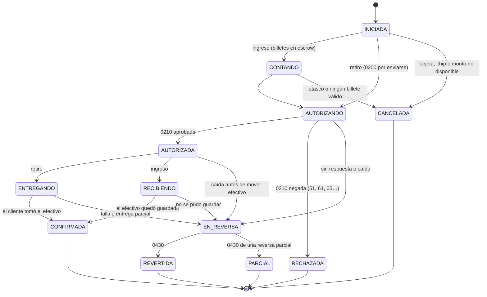
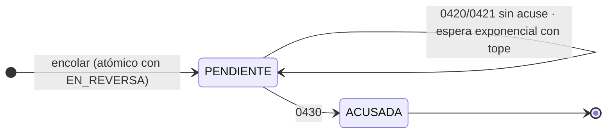
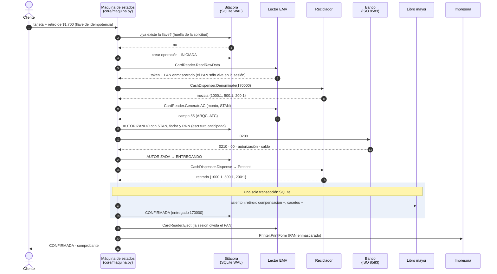
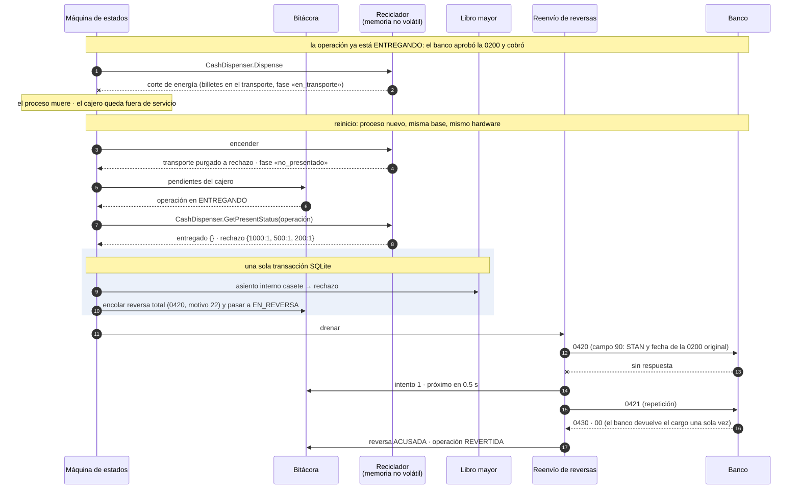
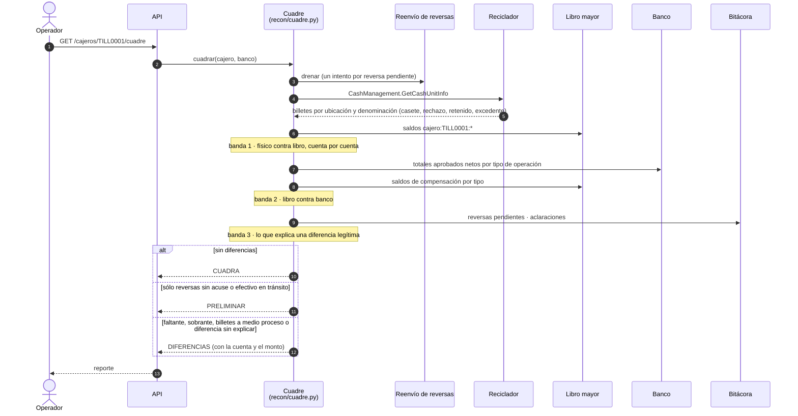
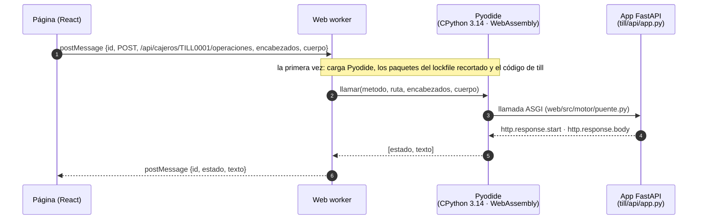

# UML · secuencias y estados

Diagramas en Mermaid (GitHub los dibuja). Están hechos con el flujo real del código; los nombres de los pasos
son los de `till/core/maquina.py`, `till/core/reversas.py` y `till/recon/cuadre.py`.

## 1. Estados de la operación

El diagrama de abajo dice exactamente lo que permite `TRANSICIONES` en `till/core/bitacora.py`:
`tests/test_maquinas_de_estado.py::test_el_diagrama_de_estados_documentado_es_el_del_codigo` falla si alguien
cambia uno sin el otro, y otra prueba recorre las 144 parejas de estados (lo no dibujado se rechaza).

La reversa tiene su propia máquina, más pequeña: `PENDIENTE → ACUSADA`, una sola vez (`acusar_reversa`
regresa `False` si ya estaba acusada), y una sola reversa por operación (`tx_id` único).

## 2. Retiro sin fallas

## 3. Reversa tras un apagón a media entrega

El corte llega mientras los billetes están en el transporte del reciclador. Nada de lo que estaba en memoria
sobrevive; sólo la bitácora y la memoria no volátil del dispositivo.

Si el corte llega **después** de que el cliente tomó el efectivo, la memoria no volátil dice «retirado» y la
recuperación **confirma** la operación (no hay reversa). Ver `tests/test_fallas.py::test_retiro_con_falla`
(`corte_tras_retiro`) y la tabla de recuperación en `tests/test_maquinas_de_estado.py`.

## 4. Cuadre de fin de día

## 5. Una solicitud de la demo publicada (API en el navegador)

