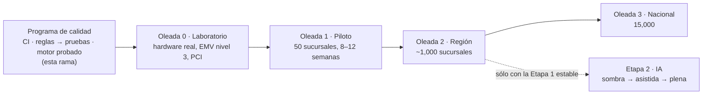

# Visión de arquitectura · Till

Visión al estilo **TOGAF ADM ligero**: fase A (visión, partes interesadas, drivers, metas, principios), fases
B–D (línea base contra objetivo en negocio, datos, aplicación y tecnología), análisis de brechas y fases E–F
(hoja de ruta). Todo sale del código y de los documentos del repositorio; las metas numéricas son las
**propuestas** de [`docs/etapas.md`](../etapas.md), no compromisos. Till es ficticio y genérico: no representa a
ningún banco ni empresa.

## 1. Propósito y alcance

Till es la implementación de referencia abierta de una red de **15 000 cajeros de sucursal automatizados**:
máquinas que hacen lo que hace un cajero humano en ventanilla (retiro, depósito, pago de crédito, envío de
remesa) con las garantías que un banco exige. Esta visión cubre la **Etapa 1** (automatización determinista,
con todo lo físico y el banco simulados) y deja trazada la **Etapa 2** (IA detrás de una compuerta de reglas).

Fuera de alcance: hardware real, emisión de tarjetas, PIN, liquidación interbancaria, multimoneda y el
proceso de aclaraciones con el cliente (ver «Alcance honesto» en el README).

## 2. Partes interesadas y sus preocupaciones

| Parte interesada | Preocupación | Cómo la atiende la arquitectura | Dónde se ve |
|---|---|---|---|
| Cliente de sucursal | Que nunca le cobren sin darle el efectivo; que su depósito no se pierda | Principio rector, reversas almacenadas y reenviadas, efectivo retenido a nombre de la operación | Reglas R1–R9, F1–F2; [`uml.md`](uml.md) §3 |
| Banco (dueño de la red) | Exactitud contable, exposición, costo de operar 15 000 equipos | Libro de partida doble sólo-anexar, cuadre a tres bandas diario, simulador de flota | Reglas L1–L4, C1–C7, FL1–FL4 |
| Operación de la red | Saber qué pasó en cada cajero y recuperarlo tras una falla | Bitácora con historial, recuperación automática al reiniciar, traza ISO 8583, inyección de fallas | Reglas E8, F4, R5; taller de fallas de la demo |
| Riesgo, cumplimiento y auditoría | PCI DSS, rastro de auditoría, segregación de datos | PAN tokenizado en el borde, sólo-anexar, traza sin datos sensibles, escaneos en cada cambio | Reglas P1–P5, E3, L2; [`SECURITY.md`](../../SECURITY.md) |
| Ingeniería | Cambiar sin romper; saber que lo publicado es lo probado | Capas verificadas, contrato OpenAPI, una prueba por regla, el runtime publicado probado en CI | [`reglas.md`](../reglas.md), ADR 0002, job `motor` |

## 3. Drivers y metas

| Driver | Meta | Medida (propuesta, `docs/etapas.md`) |
|---|---|---|
| Sustituir 15 000 cajeros humanos de sucursal por máquinas | Disponibilidad medible por cajero a escala | ≥ 98 % por cajero al final del piloto |
| Confianza del cliente en el efectivo | Nunca cargo sin entrega ni entrega sin cargo | 0 retiros con cargo sin entrega que no se reviertan solos; p99 falla → 0430 < 5 min |
| Exactitud contable | Cuadre diario exacto | ≥ 99.5 % de días con cuadre exacto a tres bandas |
| Datos de tarjeta bajo PCI DSS | Ningún PAN en claro fuera de la sesión de tarjeta | 0 PAN en disco, trazas o comprobantes (verificado en cada prueba de fallas) |

## 4. Principios

Formato TOGAF: enunciado, fundamento e implicaciones.

**P1 · Una operación no cuenta hasta que el dispositivo confirma y el banco acusa recibo.**
*Fundamento:* el cajero es la frontera entre el dinero físico y el contable; si uno se adelanta al otro hay
un cargo sin entrega o una entrega sin cargo. *Implicaciones:* máquina de estados con escritura anticipada;
toda falla tras autorizar dispara una reversa; la recuperación revierte lo que no se pueda probar que se
entregó. (ADR 0004)

**P2 · Exactamente una vez.** *Fundamento:* en una red con tiempos agotados y reinicios, todo mensaje puede
repetirse. *Implicaciones:* llave de idempotencia por solicitud (con huella: otra solicitud con la misma llave
es un error), por asiento y por mensaje (el banco no aplica dos veces la misma 0200 ni la misma reversa).

**P3 · Sólo anexar.** *Fundamento:* auditoría y conciliación necesitan la historia, no sólo el saldo.
*Implicaciones:* triggers que impiden UPDATE/DELETE en libro e historial; una corrección es otro asiento.

**P4 · Consistencia fuerte donde se mueve dinero.** *Fundamento:* el apagón es una falla normal del dominio.
*Implicaciones:* estado y asiento en la misma transacción de SQLite; una base por cajero, no una base central
compartida. (ADR 0004)

**P5 · El PAN no sale de la sesión de tarjeta.** *Fundamento:* PCI DSS. *Implicaciones:* token con llave y
enmascarado 6+4 en todo lo persistido o mostrado; la impresora se niega a imprimir un PAN completo; la traza
descarta el campo 55.

**P6 · Lo que se despliega es lo que se prueba.** *Fundamento:* lección del programa de calidad: un CI verde
sobre otro runtime no prueba nada. *Implicaciones:* la demo corre la misma app FastAPI en Pyodide y el CI
corre toda la suite con el Python y los paquetes de Pyodide, más una prueba de humo del motor real.
(ADR 0002)

**P7 · La IA propone, las reglas autorizan (Etapa 2).** *Fundamento:* ningún modelo debe mover dinero ni cambiar
el estado de una operación. *Implicaciones:* las salidas de IA son señales que una compuerta determinista
acepta o rechaza, con bitácora; la puntuación de fraude sólo puede endurecer las reglas.

**P8 · Simulación honesta.** *Fundamento:* una referencia sólo sirve si dice qué es real. *Implicaciones:* sólo
PANs de prueba; lo simulado y lo simplificado se declara (README «Alcance honesto»); las metas numéricas son
propuestas.

## 5. Línea base y objetivo (fases B–D)

La **línea base** es `main` al 18-nov-2026 (`b2c36fd`). El **objetivo de transición** es esta rama de calidad. El
**objetivo de producción** es la Etapa 1 en sucursales, según `docs/hardware.md` y `docs/etapas.md`.

| Dominio | Línea base (main) | Objetivo de transición (esta rama) | Objetivo de producción (Etapa 1) |
|---|---|---|---|
| Negocio | Retiro, depósito, pago de crédito y remesa; cuadre; flota simulada | Igual, con el límite diario por **día de negocio** en hora de la Ciudad de México y rechazo de llaves reutilizadas | Lo mismo con clientes reales en el piloto, convivencia con la ventanilla, proceso de aclaraciones |
| Datos | Bitácora y libro en SQLite (WAL); PAN tokenizado | Huella de la solicitud en la bitácora; columnas editables fijas; contrato OpenAPI versionado; lote golden de un día | Una base por cajero con réplica al centro de datos; tokenización en bóveda/HSM |
| Aplicación | Núcleo, API FastAPI, demo web; la API corre en el navegador (Pyodide) | Validación del depósito antes del escrow; nada empieza en un cajero apagado; motor con `tzdata` | Adaptador de `till/devices` a proveedores de servicio reales (XFS4IoT o el que exista); PIN con EPP y DUKPT |
| Tecnología | Vercel estático; sin CI | CI con pruebas en 3.12 y en el runtime de Pyodide (3.14), E2E de Playwright, CodeQL, Semgrep, Trivy, gitleaks, SBOM; Dependabot | PC industrial con TPM, UPS, WAN + LTE con IPsec; switch ISO 8583 con MAC; despliegue por anillos |
| Calidad | 65 funciones de prueba (92 casos); sin tabla de reglas | 95 reglas → pruebas verificadas; máquinas de estado con todas sus transiciones inválidas; paridad golden con controles negativos | Las mismas pruebas de fallas provocadas físicamente en el laboratorio |

## 6. Brechas

| Brecha | Impacto | Cómo se cierra | Estado |
|---|---|---|---|
| El runtime publicado (Python 3.14 + paquetes de Pyodide) no se probaba | Un cambio podía pasar el CI y romper la demo | Job `motor` del CI + `web/scripts/humo_motor.mjs` | Cerrada en esta rama |
| El motor no tenía base de zonas horarias: los campos 12/13 salían en UTC | Hora local de la 0200 corrida seis horas en la demo | Paquete `tzdata` en el motor; la prueba de humo lo exige | Cerrada en esta rama |
| Un depósito cuyo total no cabía en el campo 4 dejaba el escrow ocupado | El cajero dejaba de aceptar depósitos hasta reiniciarse | Validación antes de tocar el escrow (regla S4) | Cerrada en esta rama |
| La misma llave con otra solicitud devolvía la operación original | Un cliente podía creer que operó otro monto | Huella de la solicitud (regla I2) | Cerrada en esta rama |
| El límite «diario» nunca se reiniciaba | Límite de por vida | Día de negocio en hora de México (reglas H3–H4) | Cerrada en esta rama |
| Hardware real y certificación EMV/PCI | Sin esto no hay piloto | Oleada 0 · laboratorio | Abierta (fuera del repositorio) |
| PIN, EPP, DUKPT, MAC en ISO 8583, liquidación real | Requisitos de producción | Etapa 1 en laboratorio | Abierta, declarada en el README |
| Monitoreo central, despliegue por anillos | Operar 15 000 equipos | Oleada 2 · región | Abierta |

## 7. Hoja de ruta (fases E–F)

Cada oleada tiene su pregunta, sus indicadores y sus criterios de salida en [`docs/etapas.md`](../etapas.md). En
ArchiMate, la hoja de ruta está en la vista «Implementación y migración» de [`archimate.md`](archimate.md).

## 8. Riesgos y decisiones abiertas

- **Pyodide como runtime de la demo** (ADR 0002): la versión la fija el paquete npm; cambiarla cambia Python y
  FastAPI. Mitigación: el job `motor` toma las versiones del lockfile y falla si el Python cambia.
- **ISO 8583 frente a ISO 20022** (ADR 0003): la frontera con la liquidación y los reportes de cuenta es donde un
  banco con pagos internacionales usaría ISO 20022; no está implementada.
- **Una base por cajero** (ADR 0004): exige réplica confiable al centro de datos; no está diseñada en detalle.
- **Supuestos del simulador de flota**: los parámetros son ilustrativos hasta calibrarlos con la región.

## 9. Gobierno

- Las decisiones se registran como ADR con sus alternativas descartadas ([`../adr/`](../adr/)).
- La compuerta de calidad es [`../reglas.md`](../reglas.md): una regla sin prueba no entra.
- `main` está protegida por el ruleset declarado en `.github/rulesets/main.json`: todos los jobs de `ci` y
  `seguridad` son checks requeridos, y un job omitido cuenta como fallo.
