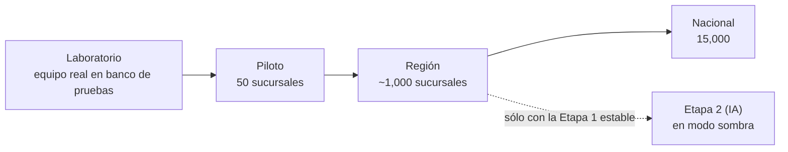

# Despliegue por oleadas

Cambiar 15 000 cajeros humanos por máquinas no se hace de una vez. Cada oleada tiene una pregunta que
responder, unos indicadores que medir y unos criterios de salida que hay que cumplir antes de pasar a la
siguiente. Las metas numéricas de este documento son **propuestas** para discutir con el negocio, no
compromisos.

## Oleada 0 · Laboratorio

**Pregunta:** ¿el software de Till se comporta igual con hardware real que con el simulado?

- Banco de pruebas con 2–3 combinaciones de reciclador, lector y EPP de distintos fabricantes.
- Adaptador de `till/devices` a los proveedores de servicio reales (XFS4IoT o el que exista).
- Las mismas pruebas de fallas del repositorio, ahora provocadas físicamente: atascar billetes, cortar
  la energía a media entrega, desconectar la red, no tomar el efectivo.
- Prueba de resistencia: miles de ciclos de retiro y depósito; cuadre al final de cada día.
- Certificación EMV de nivel 3 con el adquirente y revisión de PCI.

**Se mide:** coincidencia entre lo que reporta el dispositivo y lo que se cuenta a mano; tiempo de
recuperación tras corte; consumo real contra el presupuesto de [`hardware.md`](hardware.md).

**Para salir:** cero discrepancias sin explicar en el cuadre del laboratorio; todas las fallas del
catálogo terminan en el estado correcto; presupuesto de energía validado.

## Oleada 1 · Piloto de 50 sucursales

**Pregunta:** ¿la operación diaria funciona con clientes reales, sin perder dinero ni clientes?

- Selección deliberadamente variada: ciudad y municipio pequeño, mucho y poco tráfico, clima extremo,
  altitud, conectividad buena y mala (para ejercitar el respaldo LTE).
- **Convivencia**: el personal de ventanilla se queda durante el piloto y ayuda en el cajero; nadie es
  sustituido hasta que los indicadores lo justifiquen.
- Duración propuesta: 8–12 semanas, con al menos un fin de mes y una quincena dentro.

**Se mide:**

| Indicador | Meta propuesta |
|---|---|
| Disponibilidad por cajero (tiempo en servicio / tiempo de operación de la sucursal) | ≥ 98 % al final del piloto |
| Retiros con cargo sin entrega que **no** se revirtieron solos | 0 |
| Tiempo desde la falla hasta el 0430 de la reversa (p99) | < 5 min |
| Días con cuadre exacto a tres bandas (físico = libro = banco) | ≥ 99.5 % |
| Aclaraciones abiertas por cada 10 000 operaciones | por debajo de la ventanilla actual |
| Tiempo por operación y tasa de abandono | igual o mejor que la ventanilla |
| Satisfacción, con muestra específica de adultos mayores y personas con discapacidad | sin caída frente a la ventanilla |
| Efectivo inmovilizado por cajero y viajes de traslado de valores | línea base para la región |
| Incidentes de seguridad física y lógica | 0 graves |

**Para salir:** las metas anteriores sostenidas al menos 4 semanas seguidas; el proceso de aclaraciones
funciona con tiempos dentro de la regulación; operación y soporte técnico documentados.

## Oleada 2 · Región (~1,000 sucursales)

**Pregunta:** ¿escala la operación: soporte técnico, traslado de valores, monitoreo y actualizaciones?

- Una región completa con su cadena de soporte: técnicos de campo, traslado de valores y centro de
  monitoreo.
- Primer uso real del despliegue escalonado de actualizaciones (anillos 1 % → 10 % → 100 %).
- El simulador de flota se calibra con los datos de la región (tráfico por hora, fallas, tiempos de
  reparación) y empieza a planear rutas de reabasto.

**Se mide:** todo lo del piloto, más tiempo medio entre fallas y de reparación por modelo de equipo;
precisión del día estimado de reabasto (estimado contra real); actualizaciones con regreso automático;
costo por operación frente a la ventanilla; impacto en el personal (reubicación y capacitación).

**Para salir:** indicadores del piloto sostenidos con 20 veces más equipos; ninguna actualización que haya
requerido visita técnica masiva; modelo de costos validado.

## Oleada 3 · Nacional (15,000)

**Pregunta:** ¿se puede operar la red completa con las mismas garantías?

- Despliegue por regiones en el orden que dicte el análisis de riesgo y de negocio.
- Ventanilla humana de respaldo en sucursales críticas hasta cumplir los criterios locales.

**Se mide:** disponibilidad de la red completa, reversas y aclaraciones por región, efectivo total en la
red, viajes de traslado de valores ahorrados, energía consumida, incidentes y satisfacción.

## Etapa 2 · IA detrás de una compuerta de reglas

La IA entra **sólo** cuando la Etapa 1 está estable a escala regional, y siempre bajo el mismo principio:
**la IA propone, las reglas autorizan**. Ningún modelo mueve dinero ni cambia el estado de una operación;
sus salidas son señales que una compuerta determinista acepta o rechaza, con bitácora de cada decisión.

| Capacidad | Qué propone la IA | Qué autoriza la regla |
|---|---|---|
| Asistente por voz | Interpretar lo que pide el cliente y armar la operación | La operación se confirma en pantalla y sigue el mismo flujo AUTORIZAR → ENTREGAR → CONFIRMAR |
| Verificación de identidad por visión | Una puntuación de coincidencia contra el expediente | Umbrales fijos por tipo y monto de operación; si no alcanza, se pide otro factor o se envía a ventanilla |
| Detección de fraude | Una puntuación de riesgo por operación | Límites y bloqueos definidos por el área de riesgo; la puntuación sólo puede endurecer, nunca relajar, las reglas |

Cada capacidad pasa por tres fases en las sucursales donde se activa:

1. **Modo sombra**: la IA opina pero no influye; se mide contra lo que realmente pasó.
2. **Asistida**: la compuerta usa la señal en casos de bajo riesgo; se miden falsos positivos y negativos.
3. **Plena**: dentro de los umbrales aprobados, con revisión periódica del modelo y de sus sesgos.

**Se mide:** falsos positivos (clientes legítimos bloqueados) y falsos negativos (fraude no detectado)
por segmento de población; tiempo de operación con y sin asistente; tasa de derivación a ventanilla.
