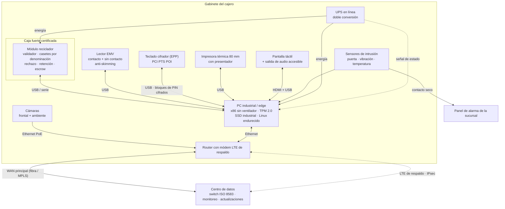

# Diseño de referencia del hardware

Este documento describe el hardware que Till simula. Es un diseño de referencia para discutir con
proveedores, no una lista de compra: las cifras marcadas como **(estimado)** son supuestos de
ingeniería para dimensionar y se validan con equipo real en el laboratorio y en el piloto
(ver [`etapas.md`](etapas.md)). No se nombran marcas de equipo; las categorías y los requisitos sí son
concretos.

## 1. Diagrama de bloques

## 2. Lista de materiales por categoría

| # | Categoría | Requisito de referencia | Notas |
|---|---|---|---|
| 1 | **PC industrial / edge** | x86-64 sin ventilador, 4–8 núcleos, 16 GB RAM, SSD industrial de 256 GB con protección contra cortes, **TPM 2.0** discreto, UEFI con Secure Boot configurable con llaves propias, watchdog de hardware, puertos USB internos bloqueables, rango de operación 0–50 °C (estimado). | Corre Linux endurecido, la aplicación de Till y el agente de actualizaciones. La bitácora y el libro local viven en una partición de datos cifrada. |
| 2 | **Módulo reciclador de efectivo** | Recicla las 6 denominaciones MXN vigentes en billete (20, 50, 100, 200, 500, 1000); validación y detección de billetes falsos o no aptos; escrow; casete de rechazo y de retención; presentador con persiana anti-pesca; contadores en memoria no volátil; capacidad total del orden de 10 000–15 000 billetes (estimado). | Debe reportar la fase de cada operación tras un corte (Till consulta `GetPresentStatus` / `GetCashInStatus`). El firmware se actualiza con herramientas firmadas del fabricante. |
| 3 | **Caja fuerte** | Certificada UL 291 o EN 1143-1; el grado se define con el análisis de riesgo de cada sitio. Anclaje al piso o muro. | Aloja el reciclador. Cerradura electrónica con doble control para el traslado de valores. |
| 4 | **Lector de tarjetas EMV** | Contacto (EMV nivel 1 y 2) y sin contacto; motorizado o de inserción con detección de skimming y de objetos extraños; captura de tarjeta. | El PAN se tokeniza en el borde: nunca se persiste en claro. |
| 5 | **Teclado cifrador (EPP)** | Aprobado **PCI PTS POI**; responde a intrusión borrando llaves; DUKPT; carga remota de llaves (TR-34) y bloques de llave TR-31; escudo de privacidad; braille. | El PIN nunca existe en claro fuera del EPP. Till aún no simula PIN (ver alcance en el README). |
| 6 | **Impresora térmica** | 80 mm, corte automático, presentador con retracción, sensor de poco papel; rollo de alta capacidad. | Una falla de impresora no revierte la operación; el comprobante se reimprime o se envía por otro medio. |
| 7 | **Cámaras** | Frontal (rostro del usuario) y de ambiente; PoE; grabación local cifrada con retención según la política del banco. | En la Etapa 2 alimentan la verificación de identidad. La colocación respeta la privacidad: nunca enfocan el teclado. |
| 8 | **UPS** | En línea (doble conversión), ~1 kVA, con señal de estado hacia el PC (USB o red). Autonomía para terminar la operación en curso, purgar el transporte y apagar en orden (ver §3). | Al pasar a batería, la aplicación debe dejar de aceptar operaciones nuevas y terminar la que está en curso (diseño; la simulación actual no modela la UPS). |
| 9 | **Comunicaciones** | Router con dos salidas: WAN principal de la sucursal y **módem LTE de respaldo** (APN privado); túnel IPsec al centro de datos; conmutación automática. | El tráfico ISO 8583 es pequeño (kilobytes por operación); las actualizaciones se programan para la WAN principal. |
| 10 | **Sensores y alarma** | Puerta del gabinete y de la caja, vibración/sísmico, temperatura (corte térmico), inclinación; integración con el panel de alarma de la sucursal y con el monitoreo central. | Un evento de intrusión pone al cajero fuera de servicio y avisa. |
| 11 | **Interfaz y accesibilidad** | Pantalla táctil de ~21" de alto brillo, conector de audífonos con guía por voz, alturas de alcance accesibles. | Los requisitos de accesibilidad aplicables se validan con el área de cumplimiento. |

Los costos quedan fuera de este documento: se cotizan con proveedores durante el laboratorio y el piloto.

## 3. Presupuesto de energía (estimado)

| Componente | Reposo (W) | Pico (W) |
|---|---:|---:|
| PC industrial / edge | 15 | 45 |
| Pantalla táctil | 25 | 35 |
| Módulo reciclador (motores de transporte y validador) | 40 | 350 |
| Lector EMV | 3 | 8 |
| EPP | 1 | 3 |
| Impresora térmica | 3 | 70 |
| Cámaras (2, PoE) | 8 | 12 |
| Router + módem LTE | 8 | 15 |
| Sensores, iluminación y ventilación del gabinete | 15 | 40 |
| **Total** | **≈ 120** | **≈ 580** (si todo coincidiera) |

Lectura de la tabla (todo **estimado**):

- El pico real es menor que la suma: el reciclador y la impresora rara vez trabajan al mismo tiempo.
  Para dimensionar se usa ~500 W.
- Consumo diario por cajero: ~120 W × 24 h ≈ 2.9 kWh, más ~0.5 kWh por los picos de unas 150
  operaciones diarias ⇒ **≈ 3.4 kWh/día**. Para 15 000 cajeros, del orden de 50 MWh/día.
- UPS: terminar una operación, purgar el transporte y apagar en orden toma pocos minutos a ~250 W
  promedio; para cubrir además microcortes y apagones cortos se sugiere autonomía de ~30 min en reposo.
  Con ~150 Wh útiles de batería se cubren ambos casos con margen. Se valida con mediciones en el piloto.

## 4. Arranque seguro y raíz de confianza

1. **UEFI Secure Boot con llaves propias** (PK/KEK/db del operador; se retiran las llaves de fábrica).
   Sólo arranca un cargador y un kernel firmados (imagen unificada del kernel con su initramfs).
2. **Sistema raíz de sólo lectura** verificado con dm-verity: cualquier byte alterado detiene el arranque.
3. **Arranque medido**: cada etapa se mide en los PCR del **TPM 2.0**.
4. **Partición de datos cifrada** (LUKS2) con la llave sellada a los PCR del TPM: si alguien cambia el
   firmware o el sistema, el disco no se abre. Ahí viven la bitácora, el libro local y las reversas pendientes.
5. **Atestación remota**: antes de habilitar el enlace con el banco, el centro de datos pide al TPM una
   cita firmada de los PCR. Las credenciales del enlace (certificado de cliente para mTLS/IPsec) se
   entregan sólo a un equipo atestado; la identidad del equipo es una llave que nunca sale del TPM.
6. Puertos USB externos deshabilitados, contraseña de firmware, orden de arranque bloqueado y watchdog
   de hardware que reinicia el equipo si la aplicación deja de responder.

## 5. Actualizaciones remotas

- **Esquema A/B** con un agente de actualizaciones sobre el aire como **RAUC** o **Mender**: la nueva
  versión se escribe en la partición inactiva y se arranca de prueba.
- Paquetes **firmados**; el agente rechaza lo que no venga firmado por el operador.
- **Verificación de salud** después de arrancar: autoprueba de la aplicación, estado de cada dispositivo
  (`Common.Status`) y eco con el banco (0800/0810). Si algo falla, **regreso automático** a la versión
  anterior.
- La actualización sólo se aplica con el cajero en reposo: sin operación en curso y, de preferencia, sin
  reversas pendientes (las pendientes sobreviven porque viven en la partición de datos).
- **Despliegue escalonado** por anillos alineados con las oleadas: 1 % de la flota, luego 10 %, luego el
  resto, con pausa automática si suben los indicadores de falla.
- Ventanas fuera del horario de la sucursal; por LTE sólo actualizaciones críticas o diferenciales.
- El firmware de los dispositivos (reciclador, EPP, lector) sigue un ciclo propio, menos frecuente, con
  las herramientas firmadas de cada fabricante.

## 6. Seguridad física

- Caja fuerte certificada y anclada; doble control y sellos en los casetes para el traslado de valores.
- Sensores de puerta, vibración, temperatura e inclinación conectados a la alarma y al monitoreo.
- Lector con detección de skimming y de objetos extraños; persiana del presentador con protección
  anti-pesca y anti-atrapamiento.
- EPP con respuesta a intrusión (borra llaves) y escudo de privacidad; cámaras que nunca enfocan el teclado.
- Opcional según riesgo del sitio: sistema de entintado de billetes (IBNS) en la caja.
- Ubicación dentro de la sucursal, con cierre del vestíbulo fuera de horario cuando aplique.

## 7. Notas de PCI y XFS

- **PCI PTS POI**: aplica al EPP (y al lector, según la configuración aprobada). El PIN se cifra dentro
  del EPP (bloque de PIN ISO 9564) bajo DUKPT o bajo una llave cargada por TR-34; la aplicación sólo
  maneja el bloque cifrado (campo 52 de la 0200).
- **PCI PIN Security** rige la administración de llaves (ceremonias, carga remota, rotación).
- **PCI DSS**: Till reduce el alcance desde el diseño: tokenización en el borde, ningún PAN en claro en
  disco ni en bitácoras (hay una prueba que lo verifica), segmentación de la red de cajeros y mTLS/IPsec
  hacia el centro de datos. El PCI SSC publica además lineamientos de seguridad específicos para cajeros
  que sirven como lista de verificación.
- **CEN/XFS 3.x** es la interfaz clásica de dispositivos de cajero, ligada a Windows (API en C).
  **XFS4IoT** es su sucesora independiente del sistema operativo (mensajes JSON sobre WebSocket), lo que
  permite un PC edge con Linux. La capa `till/devices` se **inspira** en XFS4IoT (comandos con nombre
  `Interfaz.Comando`, terminaciones con código, eventos asíncronos) para que un adaptador futuro traduzca
  uno a uno. La disponibilidad de proveedores de servicio XFS4IoT varía por fabricante y se confirma en
  el laboratorio.
- **EMV**: el kernel de contacto y sin contacto lo certifica el fabricante del lector (niveles 1 y 2);
  la certificación de nivel 3 (extremo a extremo con el adquirente) es parte del piloto.
- Regulación local (CNBV y Banxico) y requisitos del banco se validan con cumplimiento antes del piloto.
